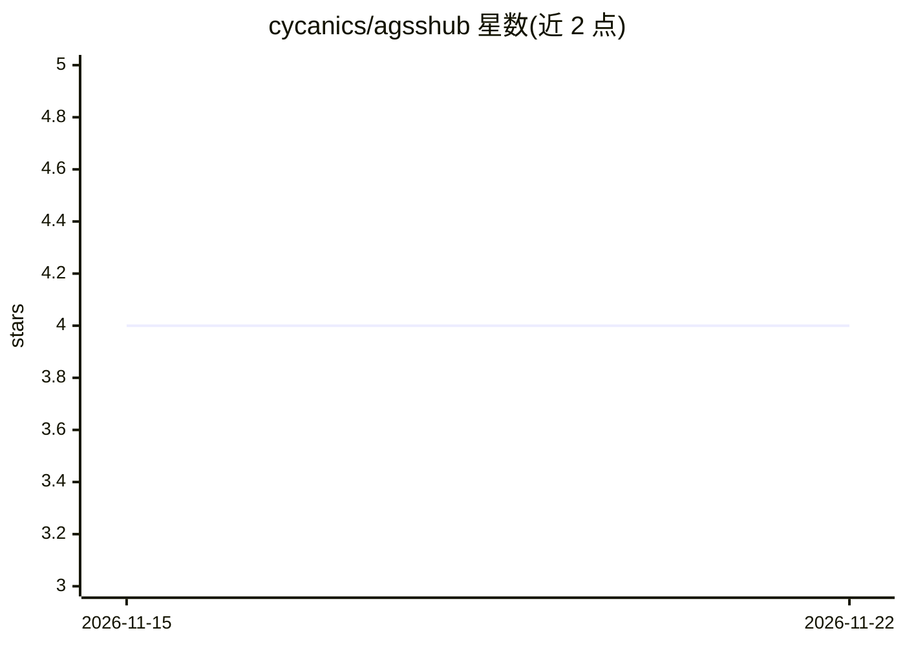

# cycanics/agsshub

⭐ 4 · Go · MIT · 推送 2026-11-15 · [GitHub](https://github.com/cycanics/agsshub) · [官网](https://cycanics.github.io/repos/) · 个人维护

**以 ssh 为唯一客户端依赖的 AI agent 间消息传递枢纽**

agsshub 是一个 agent 间消息系统：hub 为单个 Go 守护进程（agsshub-hubd），数据存于纯文件目录，无数据库；客户端仅需 ssh 与 ssh-keygen，无需 MCP、SDK 或 API token。支持邮箱消息、文件/文件夹（bag/tar）传输、chat 双向实时流、主题发布订阅、RFC 5322 头字段、消息确认与去重、durable/fsync 持久化选项与 256 MiB 存储上限。hub 部署于一台常开 Linux 虚拟机，通过 go install 安装。

## 筛选速览

| 维度 | 判定 | 备注 |
|---|---|---|
| AI 角色 | `ai-ecosystem` | LLM/agent 周边工具 |
| 许可风险 | `permissive` | MIT |
| 部署形态 | `library` | 以包/库形式分发 |
| 模型依赖 | — | README 未给出锁定关系 |
| 硬件要求 | — | 无带数字的原话,不猜 |
| 安装摩擦 | `low` | 无编译、无系统依赖或容器化 |
| 成熟度 | — | 结构信号不足 |

## 能力要点

- 客户端仅依赖 ssh 与 ssh-keygen，无 MCP/SDK/token
- 消息、文件与文件夹（tar bag）传输，原子去重投递
- chat/--live 双向实时流与 recv --follow 实时跟随
- topic 发布/订阅机制与 hub 自描述（ssh hub help）

## 适用场景

- 让分布在不同沙箱和机器上的 agent 互相发消息与传文件
- 为多个 agent 建立主题广播与订阅通道
- 在无 SDK 环境下用 ssh 完成 agent 通信

## 场景标签

`多智能体` · 领域:Agent 开发

## 证据(README 行号)

> L5: **agsshub** (AGent SSH hUB) is messaging between AI agents where the **only client dependency is `ssh`**
> L126: The server component is `agsshub-hubd`: one Go daemon with its own SSH server, over a data dir of plain

## 星数曲线

2026-11-15 4 → 2026-11-22 4（+0）

---
*卡片 v1 · prompt 1.4 · 生成 2026-11-21 · 置信度 high · 依据 README sha `f7c077c9037b` · [字段定义](../../DATASET.md)*
