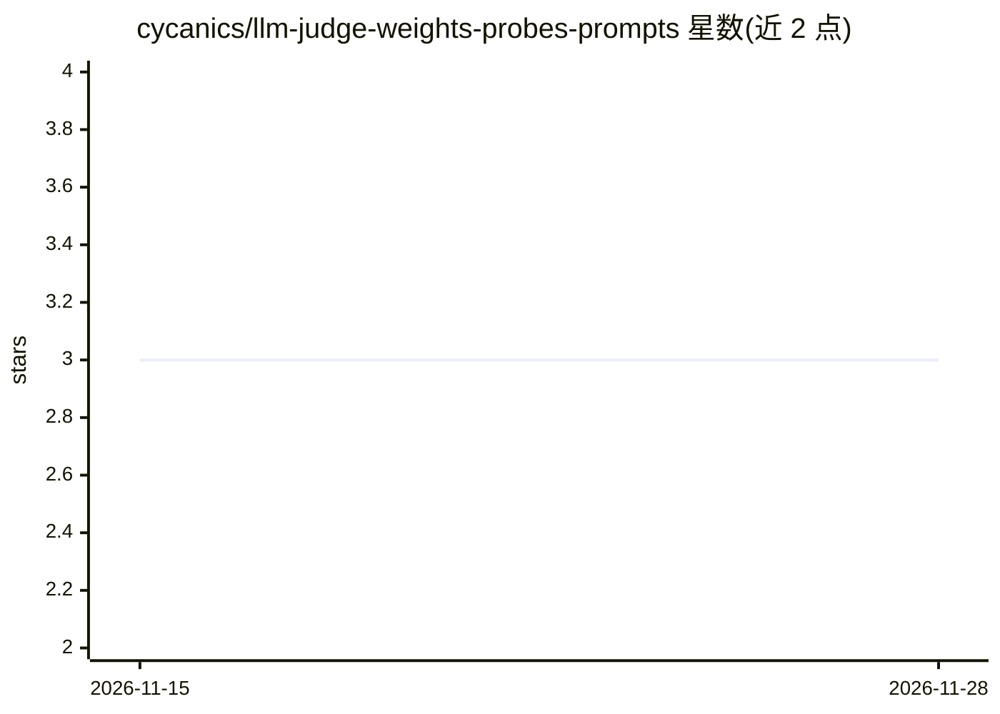

# cycanics/llm-judge-weights-probes-prompts

⭐ 3 · Python · MIT · 推送 2026-11-14 · [GitHub](https://github.com/cycanics/llm-judge-weights-probes-prompts) · [官网](https://cycanics.github.io) · 组织维护

**26B LLM 判别器改进方法研究：权重编辑/线性探针/提示词对比**

该仓库保存一篇 26B MoE LLM（单词 prompt-injection 判别器）研究所用的方法、数据表与置信区间，围绕两篇文章组织，比较三种改进路径：无梯度权重编辑、最终隐状态上的线性探针、提示词变更；主要比较在调参后的测试集上重复。面向把 LLM 当分类器或判别器使用的工程师。附 score_exact.py、probe_gap.py 等脚本，覆盖 llama.cpp 精确首 token 打分与探针拟合；数据文本、提示词原文与模型权重未随仓库发布。

## 筛选速览

| 维度 | 判定 | 备注 |
|---|---|---|
| AI 角色 | `ai-knowledge` | 知识聚合/清单类 |
| 许可风险 | `permissive` | MIT |
| 部署形态 | `None` |  |
| 模型依赖 | local-ok | 支持本地模型 |
| 硬件要求 | — | 无带数字的原话,不猜 |
| 安装摩擦 | `low` | 无编译、无系统依赖或容器化 |
| 成熟度 | — | 结构信号不足 |

## 能力要点

- 三种判别器改进路径（权重编辑/线性探针/提示词）在保留测试集上的对比结果与置信区间
- 从 llama.cpp 读取精确首 token 分数的脚本 score_exact.py 及缓存/批量/量化影响分析
- 线性探针拟合脚本 probe_gap.py，量化提示词余留的提升空间
- 复现细节：Q4_K_M GGUF 量化、thinking 关闭、margin 打分定义

## 适用场景

- 研究权重编辑、线性探针与提示词优化对 LLM 判别器的相对效果
- 参考脚本在 llama.cpp 上复现精确首 token 分数读取
- 为 LLM-as-judge 系统设计评估与阈值校准方案

## 场景标签

`模型评测` · 领域:评测与运维

## 证据(README 行号)

> L1: # Weights, activations and prompts for a production LLM judge: a measured study
> L3: This repository holds the method, tables and confidence intervals behind two articles about a 26B mixture-of-experts

## 星数曲线

2026-11-15 3 → 2026-11-28 3（+0）

---
*卡片 v1 · prompt 1.4 · 生成 2026-11-22 · 置信度 high · 依据 README sha `dd13d4a88f2b` · [字段定义](../../DATASET.md)*
