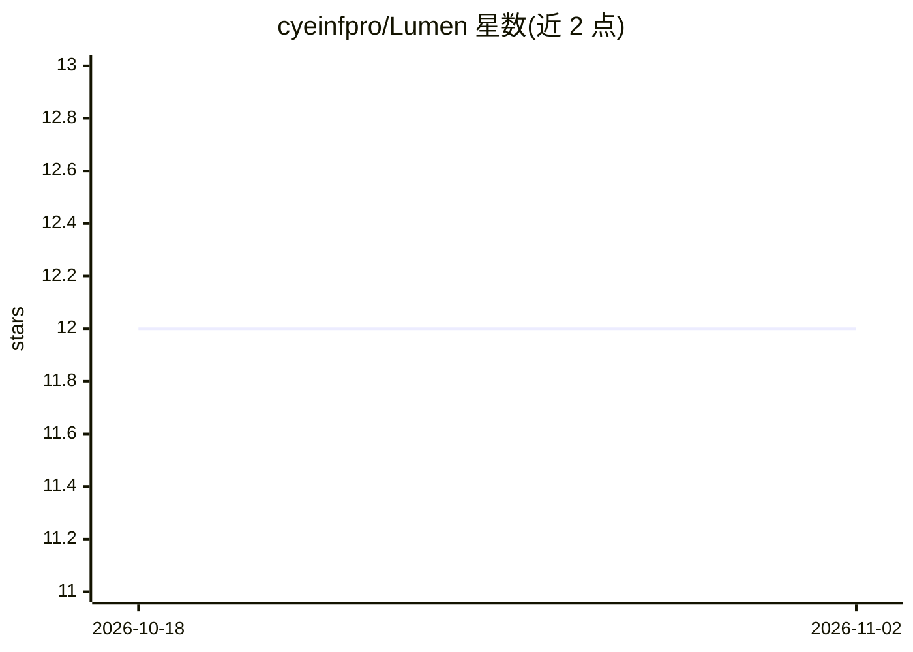

# cyeinfpro/Lumen

⭐ 12 · Python · NOASSERTION · 推送 2026-11-01 · [GitHub](https://github.com/cyeinfpro/Lumen) · 组织维护 · 中文 README

**自托管多模态 AI 创作工作台：聊天/视觉问答/文生图/图生图**

私有部署的多模态 AI 应用，把文本聊天、视觉问答、文生图/图生图/inpaint、视频生成、Storyboard 与资产管理放进同一 Web 界面，并提供 Telegram Bot 入口。面向想自建 AI 服务的个人或团队：Docker Compose 全栈（Next.js Web、FastAPI、arq Worker、Agent Runtime、PostgreSQL 16 + pgvector、Redis 7），配 Provider Pool（优先级/权重/限流/熔断）、计费、备份恢复与更新运维。桌面客户端已停止维护并下架，仅剩 Web/Docker 部署。

## 筛选速览

| 维度 | 判定 | 备注 |
|---|---|---|
| AI 角色 | `ai-native` | 本体是模型或模型工具 |
| 许可风险 | `none` | NOASSERTION |
| 部署形态 | `self-host` | docker 或自建部署 |
| 模型依赖 | — | README 未给出锁定关系 |
| 硬件要求 | — | 无带数字的原话,不猜 |
| 安装摩擦 | `low` | 无编译、无系统依赖或容器化 |
| 成熟度 | — | 结构信号不足 |

## 能力要点

- 聊天/视觉问答/文生图/图生图/inpaint/视频生成同一工作台
- Provider Pool：优先级、权重、限流、熔断与 failover
- SSE replay 与任务快照支持长任务断线恢复
- 一键安装脚本与 stable/main 双更新通道、备份恢复、Prometheus/Sentry/OTEL 接入

## 适用场景

- 私有部署一个多模态 AI 聊天与生图/生视频工作台
- 通过 Telegram Bot 在移动端生成与管理任务
- 小团队自管 Provider、配额与计费的 AI 服务

## 场景标签

`图像生成` `视频生成` `多模态` `聊天机器人` · 领域:对话与助手

## 证据(README 行号)

> L3: Lumen 是一个自托管的多模态 AI 创作工作台。它把聊天、视觉问答、文生图、图生图、视频生成、Storyboard、资产流、分享、Telegram Bot、Provider 管理、计费和更新运维放在同一个私有部署里。
> L19: - **Studio**：文本聊天、视觉问答、图片生成/编辑、inpaint、工具调用、全局任务托盘。

## 星数曲线

2026-10-18 12 → 2026-11-02 12（+0）

---
*卡片 v1 · prompt 1.4 · 生成 2026-11-01 · 置信度 high · 依据 README sha `e6f625375785` · [字段定义](../../DATASET.md)*
