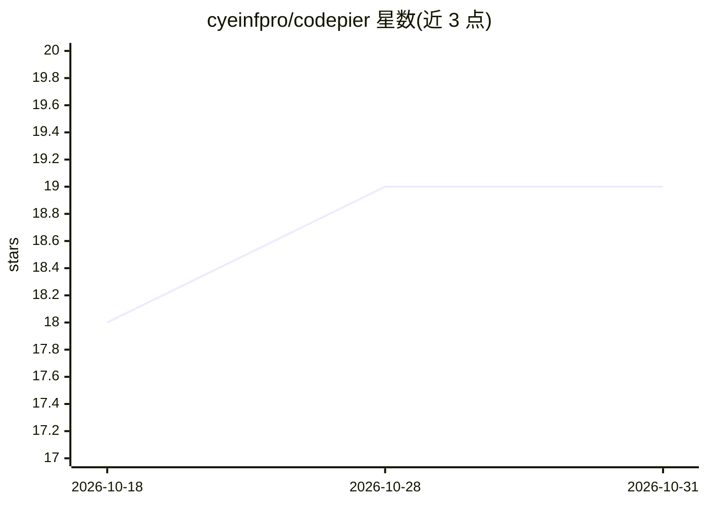

# cyeinfpro/codepier

⭐ 19 · Python · MIT · 推送 2026-10-30 · [GitHub](https://github.com/cyeinfpro/codepier) · 组织维护 · 中文 README

**自托管 MCP 服务与开发面板：让 ChatGPT 安全操作本地项目**

自托管的 MCP 服务与开发面板，由 Hub（接入与管理）和 Agent（在 macOS/Windows/Linux 运行本机工具）组成。通过 MCP 连接 ChatGPT，按授权目录搜索、读取、SHA 校验修改文件，运行命令与测试；支持在网页继续 Pi、Codex、Claude Code 会话，管理多台电脑与 VPS，可接入浏览器与桌面操作（桌面仅验证 macOS）。不提供模型服务，需自带模型客户端；Shell 以 Agent 账号权限执行，非操作系统沙箱。

## 筛选速览

| 维度 | 判定 | 备注 |
|---|---|---|
| AI 角色 | `ai-ecosystem` | LLM/agent 周边工具 |
| 许可风险 | `permissive` | MIT |
| 部署形态 | `self-host` | docker 或自建部署 |
| 模型依赖 | — | README 未给出锁定关系 |
| 硬件要求 | — | 无带数字的原话,不猜 |
| 安装摩擦 | `low` | 无编译、无系统依赖或容器化 |
| 成熟度 | — | 结构信号不足 |

## 能力要点

- Hub+Agent 架构，项目留在本机、开发电脑无需公网入站端口
- 按 Space/项目/工具划分 OAuth/PAT 权限，保留操作编号与审计记录
- 清洁模式使用独立 HOME 与非登录 Shell，可复用已有 GitHub/SSH 登录
- 通过 MCP 端点将本地项目接入 ChatGPT，支持文件读写与命令执行的分级授权

## 适用场景

- 让 ChatGPT 在授权范围内读取和修改本地项目代码、运行测试
- 在网页中继续管理 Pi、Codex、Claude Code 编程会话
- 一台 Hub 管理多台开发电脑与已分配的 SSH 服务器

## 场景标签

`编码 Agent` · 领域:编码与开发

## 证据(README 行号)

> L8: CodePier 是自托管的 MCP 服务和开发面板。**Hub** 负责接入与管理，**Agent** 在 macOS、Windows 或 Linux 上运行本机工具。你也可以在网页里继续 Pi、Codex、Claude Code
> L72: CodePier **不提供模型服务**。只使用 MCP 文件与命令工具，不需要安装模型 CLI；使用原生会话时，需在 Agent 电脑上自行安装、登录相应 CLI，模型费用沿用其配置。

## 星数曲线

2026-10-18 18 → 2026-10-31 19（+1）

---
*卡片 v1 · prompt 1.4 · 生成 2026-10-29 · 置信度 high · 依据 README sha `c8562363f592` · [字段定义](../../DATASET.md)*
