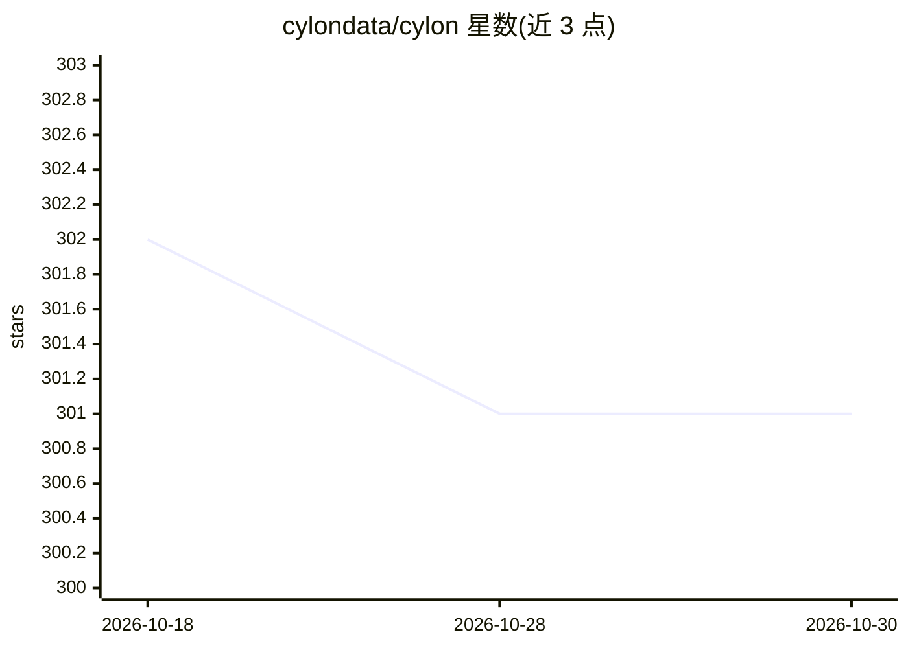

# cylondata/cylon

⭐ 301 · Jupyter Notebook · Apache-2.0 · 推送 2026-05-26 · [GitHub](https://github.com/cylondata/cylon) · [官网](https://cylondata.org) · 组织维护

**分布式内存并行 DataFrame 库：用类 Pandas 接口处理结构化数据**

C++/C++ 系核心实现的分布式内存数据并行库，提供关系算子（如 join）处理结构化数据，默认通过 MPI 分发执行。提供 Python 与 Java 接口，内部以 Apache Arrow 列式格式表示数据，供数据与 AI/ML 工程师以熟悉语言调用。当前仅支持 Linux 系统（Conda 二进制需 Ubuntu 16.04+），通过 Conda 安装 PyCylon，也可自行编译。以 Apache License 2.0 发布。

## 筛选速览

| 维度 | 判定 | 备注 |
|---|---|---|
| AI 角色 | `ai-ecosystem` | LLM/agent 周边工具 |
| 许可风险 | `permissive` | Apache-2.0 |
| 部署形态 | `None` |  |
| 模型依赖 | — | README 未给出锁定关系 |
| 硬件要求 | — | 无带数字的原话,不猜 |
| 安装摩擦 | `low` | 无编译、无系统依赖或容器化 |
| 成熟度 | — | 结构信号不足 |

## 能力要点

- 分布式内存数据并行处理，实现关系算子（join 等）
- 提供 Python（PyCylon）与 Java 接口
- 内部使用 Apache Arrow 列式数据表示，默认 MPI 分发
- 类 Pandas DataFrame API

## 适用场景

- 在多机上并行执行 DataFrame join 等数据处理
- 作为 AI/ML 流水线的数据预处理组件
- 在现有 Python/Java 应用中集成分布式数据处理

## 场景标签

 · 领域:数据处理/分布式计算

## 证据(README 行号)

> L6: Cylon is a fast, scalable distributed memory data parallel library
> L10: both data and AI/ML engineers to invoke data processing operators in a familiar programming language.

## 星数曲线

2026-10-18 302 → 2026-10-30 301（-1）

---
*卡片 v1 · prompt 1.4 · 生成 2026-10-22 · 置信度 high · 依据 README sha `76cb62e0435f` · [字段定义](../../DATASET.md)*
