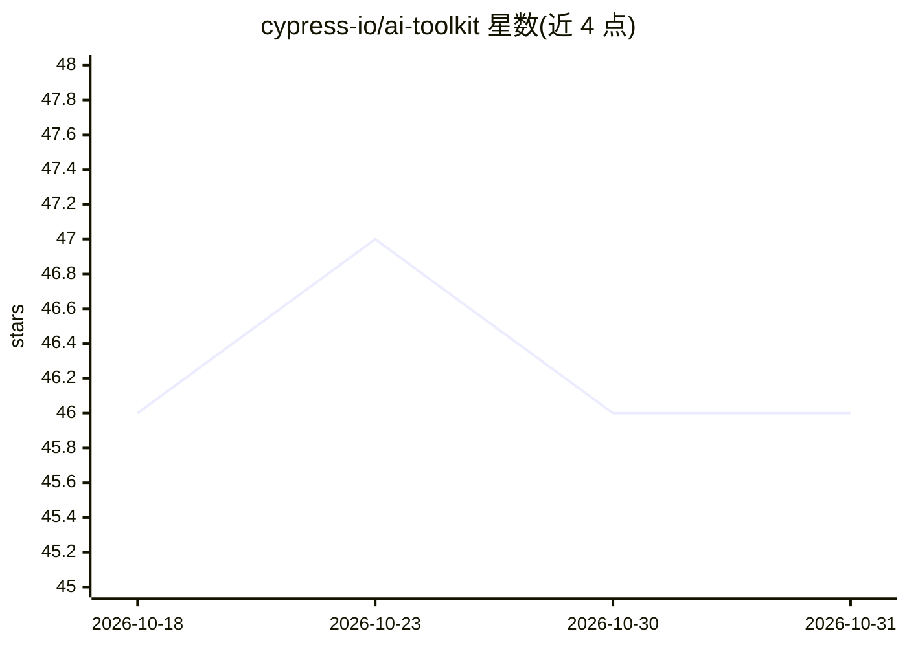

# cypress-io/ai-toolkit

⭐ 46 · TypeScript · MIT · 推送 2026-10-23 · [GitHub](https://github.com/cypress-io/ai-toolkit) · [官网](https://www.cypress.io) · 组织维护

**Cypress 官方 AI 技能包：让 AI 编码工具正确使用 Cypress**

由 Cypress 团队维护的开源工具包，为 Claude、Cursor、GitHub Copilot 等 AI 编码工具提供 Cypress 领域知识与上下文：包含 5 个技能（cypress-author/explain/docs/tap/cloud-cli，覆盖测试编写、审查、文档检索、驱动运行中会话、查询 Cloud 数据）以及连接 Cypress Cloud 的 MCP 服务器与各 agent 安装器。技能通过 Claude 插件市场、npx skills add 或 gh skill install 安装，兼容任何接受自定义指令的 AI 工具。

## 筛选速览

| 维度 | 判定 | 备注 |
|---|---|---|
| AI 角色 | `ai-ecosystem` | LLM/agent 周边工具 |
| 许可风险 | `permissive` | MIT |
| 部署形态 | `library` | 以包/库形式分发 |
| 模型依赖 | — | README 未给出锁定关系 |
| 硬件要求 | — | 无带数字的原话,不猜 |
| 安装摩擦 | `low` | 无编译、无系统依赖或容器化 |
| 成熟度 | — | 结构信号不足 |

## 能力要点

- 5 个技能：测试编写/审查/文档检索/驱动运行中会话/Cloud 数据查询
- Cypress Cloud MCP 服务器接入应用健康与稳定性数据
- 提供 Claude/Cursor/VS Code 三种 agent 的一键安装器
- 以插件形式发布并支持自动更新

## 适用场景

- 让我的 AI 编码工具按 Cypress 惯例和最佳实践写测试
- 审查与诊断现有 Cypress 测试套件
- 让 agent 直接查询 Cypress Cloud 的运行与失败数据

## 场景标签

`提示工程` · 领域:Agent 开发

## 证据(README 行号)

> L10: Open-source Cypress AI skills, built by the Cypress team. Works with Claude, Cursor, GitHub Copilot, and more.
> L44: Skills are instruction sets your AI tool loads to apply Cypress-specific knowledge when generating or reviewing tes
> L54: Skills work with any AI tool that accepts custom instructions, including Claude, Cursor, and GitHub Copilot.

## 星数曲线

2026-10-18 46 → 2026-10-31 46（+0）

---
*卡片 v1 · prompt 1.4 · 生成 2026-10-25 · 置信度 high · 依据 README sha `2ca2b9fd9db3` · [字段定义](../../DATASET.md)*
