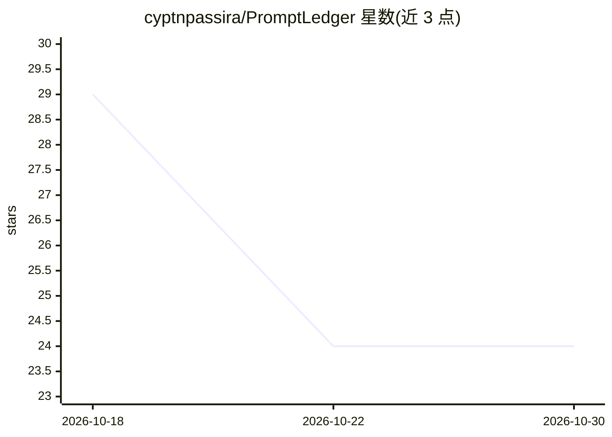

# cyptnpassira/PromptLedger

⭐ 24 · Python · Apache-2.0 · 推送 2026-09-03 · [GitHub](https://github.com/cyptnpassira/PromptLedger) · [官网](https://rustdesk.com) · 个人维护

**提示词版本管理与确定性评测工具：模板指纹、快照对比、报告**

面向提示词工程的双语言工具集：Python 核心 CLI 负责模板编写、修订记录（基于 SHA-256 内容指纹的追加式账本）、跨用例快照对比、候选回答打分（词汇 Jaccard、关键词覆盖、长度带、罚项四信号加权）与规范 JSON/Markdown 报告输出；Go 伴随二进制 ledgerctl 独立校验账本一致性与两份报告的差异。仅依赖标准库、无网络访问，承诺同输入同输出的确定性。给需要可复现提示词回归测试的开发者使用。

## 筛选速览

| 维度 | 判定 | 备注 |
|---|---|---|
| AI 角色 | `ai-ecosystem` | LLM/agent 周边工具 |
| 许可风险 | `permissive` | Apache-2.0 |
| 部署形态 | `None` |  |
| 模型依赖 | — | README 未给出锁定关系 |
| 硬件要求 | — | 无带数字的原话,不猜 |
| 安装摩擦 | `low` | 无编译、无系统依赖或容器化 |
| 成熟度 | — | 结构信号不足 |

## 能力要点

- 模板内容 SHA-256 指纹与追加式修订账本
- 四信号确定性打分模型（lexical/coverage/length/penalty）
- Python 与 Go 双实现交叉验证指纹一致性（ledgerctl verify）
- 仅标准库依赖，无第三方包与网络访问，报告字节级可复现

## 适用场景

- 对提示词模板改动作回归对比，判断是否引入退化
- 在 CI 中用 ledgerctl 校验账本与模板源未漂移
- 跨多个候选回答生成可 diff 的排行榜与逐用例报告

## 场景标签

`提示工程` `模型评测` · 领域:Agent 开发

## 证据(README 行号)

> L3: Version prompt templates, run deterministic comparison snapshots, score candidate responses, and ship diffable exper
> L17: The toolkit is split across two binaries that agree on exactly one thing: the fingerprint algorithm.

## 星数曲线

2026-10-18 29 → 2026-10-30 24（-5）

---
*卡片 v1 · prompt 1.4 · 生成 2026-10-27 · 置信度 high · 依据 README sha `aef58b68da8f` · [字段定义](../../DATASET.md)*
