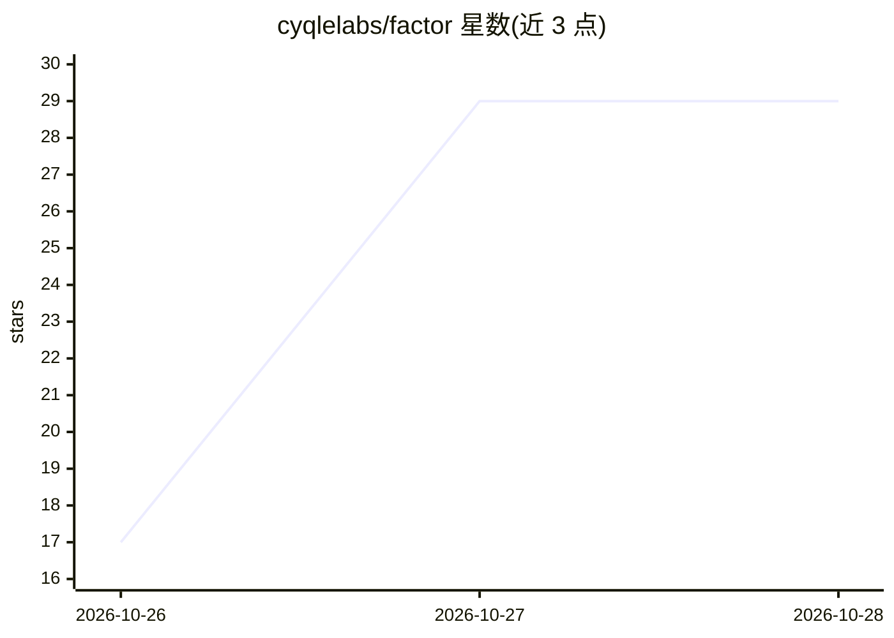

# cyqlelabs/factor

⭐ 30 · Go · MIT · 推送 2026-10-25 · [GitHub](https://github.com/cyqlelabs/factor) · [官网](https://cyqlelabs.github.io/factor/) · 组织维护

**运行在本机、可接电话的 AI 智能体（记忆+桌面+语音）**

Factor 是单个静态 Go 二进制的本地 AI agent：通过终端、Telegram、电话和本机语音与同一 agent 对话，共享同一记忆（smrti 长期记忆，做整合与优先级衰减）与工具集。它能驱动浏览器（CDP 接管 Chrome/Chromium/Brave 或托管 Camofox）、操作桌面（窗口/鼠标/键盘/截图/网格视觉）、后台运行长任务并在完成时来电或短信通知。支持 OpenAI 兼容提供商（OpenRouter/Ollama/LM Studio/Groq/llama.cpp 等）与原生 Anthropic，带故障转移、费用计量与预算上限；本地运行 322M 的 Laya 决策模型（onnxruntime，低配机用蒸馏学生模型）。限制：Laya 需 AVX2 与约 4 GB RAM；安全护栏非沙箱。面向个人用户，Windows 提供 MSI 安装包，其他平台 go install 或发布二进制。

## 筛选速览

| 维度 | 判定 | 备注 |
|---|---|---|
| AI 角色 | `ai-native` | 本体是模型或模型工具 |
| 许可风险 | `permissive` | MIT |
| 部署形态 | `desktop` | 安装包/桌面程序 |
| 模型依赖 | local-ok | 支持本地模型 |
| 硬件要求 | — | 无带数字的原话,不猜 |
| 安装摩擦 | `low` | 无编译、无系统依赖或容器化 |
| 成熟度 | — | 结构信号不足 |

## 能力要点

- smrti 长期记忆：显著性排序召回、整合衰减、remember/recall/forget/reflect 工具
- 多通道接入（终端/Telegram/电话/本机语音），同一 agent 同一记忆
- OpenAI 兼容提供商链 + 原生 Anthropic，故障转移与每调用计费、预算上限
- 本地 Laya 决策模型（onnxruntime，~350MB）与网格视觉桌面操作

## 适用场景

- 让一个本机 agent 帮我操作浏览器和桌面完成长任务
- 出差时通过电话/短信与自己的 agent 对话并接收任务完成通知
- 跨终端、Telegram、语音共享同一个带长期记忆的助手

## 场景标签

`Agent 记忆` `AI 助手` `语音 Agent` `浏览器自动化` · 领域:Agent 开发

## 证据(README 行号)

> L11: **A fast, lightweight AI agent that lives on your machine — with hands on your
> L14: Factor is a single static Go binary. Talk to it in the terminal, on Telegram, over
> L29: |🔁 **Provider failover**|OpenAI-compatible (OpenRouter, Ollama, LM Studio, Groq, llama.cpp, …) and native Anthropic

## 星数曲线

2026-10-26 17 → 2026-10-28 29（+12）

---
*卡片 v1 · prompt 1.4 · 生成 2026-10-27 · 置信度 mid · 依据 README sha `9a61bf43c023` · [字段定义](../../DATASET.md)*
