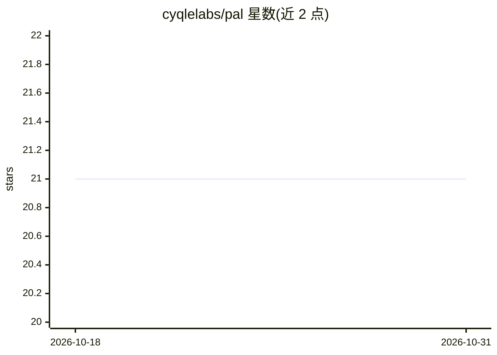

# cyqlelabs/pal

⭐ 21 · Python · MIT · 推送 2026-08-16 · [GitHub](https://github.com/cyqlelabs/pal) · [官网](https://prompt-assembly-language-pal.readthedocs.io/) · 组织维护

**将 LLM 提示词作为版本化组件管理的 Python 框架**

PAL 是一个把 LLM 提示词当作版本化、可组合软件工件来开发的 Python 框架。提供 Jinja2 模板、依赖导入与组合、Pydantic v2 校验、组件库（persona/task/context 等 9 类）、评测系统与 CLI（compile/execute/validate/evaluate 等）。内置 OpenAI、Anthropic 与自定义 provider 支持，附结构化日志与成本跟踪。以 pip/uv 安装的库与命令行工具形式提供，另有开发中的 NodeJS 版本。

## 筛选速览

| 维度 | 判定 | 备注 |
|---|---|---|
| AI 角色 | `ai-ecosystem` | LLM/agent 周边工具 |
| 许可风险 | `permissive` | MIT |
| 部署形态 | `library` | 以包/库形式分发 |
| 模型依赖 | — | README 未给出锁定关系 |
| 硬件要求 | — | 无带数字的原话,不猜 |
| 安装摩擦 | `low` | 无编译、无系统依赖或容器化 |
| 成熟度 | — | 结构信号不足 |

## 能力要点

- 提示词拆分为 9 类可复用版本化组件并通过依赖导入组合
- Jinja2 模板变量注入与 Pydantic v2 全量校验
- 内置 OpenAI/Anthropic/自定义 provider 的 LLM 集成
- 评测框架与 5 个 CLI 命令（compile/execute/validate/evaluate/info）

## 适用场景

- 团队以工程化方式管理提示词的版本与复用
- 对提示词建立测试套件并做评测验证
- 通过 CLI 或 Python API 编译并执行提示词

## 场景标签

`提示工程` · 领域:Agent 开发

## 证据(README 行号)

> L8: PAL (Prompt Assembly Language) is a framework for managing LLM prompts as versioned, composable software artifacts. 
> L17: - **LLM Integration**: Built-in support for OpenAI, Anthropic, and custom providers

## 星数曲线

2026-10-18 21 → 2026-10-31 21（+0）

---
*卡片 v1 · prompt 1.4 · 生成 2026-10-28 · 置信度 high · 依据 README sha `13f40c35fb90` · [字段定义](../../DATASET.md)*
