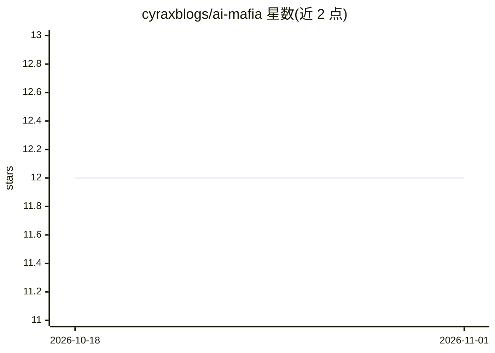

# cyraxblogs/ai-mafia

⭐ 12 · JavaScript · MIT · 推送 2026-07-04 · [GitHub](https://github.com/cyraxblogs/ai-mafia) · 个人维护

**人类玩家与 GPT/Claude/Gemini 在 3D 体素村庄玩狼人杀的浏览器游戏**

基于 Three.js 的浏览器社交推理游戏：多个真实 LLM（GPT、Claude、Gemini）扮演村民在体素夜景村庄中实时进行狼人杀对局，发言、指控与投票均由模型生成。用户可作为唯一人类玩家参与会议发言，或以纯观战模式观看 AI 对战；含白天讨论、投票放逐、夜间身份行动（Mafia/Sheriff/Doctor）的完整循环。通过 Commonstack API key 接入模型，本地需 Node.js 18+ 与 npm 9+，以 Express 后端与 Vite 前端运行；音效由 Web Audio API 合成，不随包附带音频文件。

## 筛选速览

| 维度 | 判定 | 备注 |
|---|---|---|
| AI 角色 | `ai-native` | 本体是模型或模型工具 |
| 许可风险 | `permissive` | MIT |
| 部署形态 | `library` | 以包/库形式分发 |
| 模型依赖 | — | README 未给出锁定关系 |
| 硬件要求 | — | 无带数字的原话,不猜 |
| 安装摩擦 | `low` | 无编译、无系统依赖或容器化 |
| 成熟度 | — | 结构信号不足 |

## 能力要点

- 多个真实 LLM 实时生成发言、指控与投票
- 支持人类玩家参与与纯观战两种模式
- Three.js 体素 3D 场景与 GSAP 镜头运镜
- Web Audio API 合成音效，无外部音频文件

## 适用场景

- 作为人类玩家与多个 LLM 进行狼人杀对局
- 观战模式观看纯 AI 的隐藏身份博弈过程
- 体验 LLM 驱动的 3D 社交推理游戏原型

## 场景标签

 · 领域:游戏/LLM 应用

## 证据(README 行号)

> L14: AI Mafia is a playable Three.js social deduction experience, not a generic chat wrapper. The game opens in a styliz
> L20: - It supports both human play and full spectator mode for watching AI-only matches.

## 星数曲线

2026-10-18 12 → 2026-11-01 12（+0）

---
*卡片 v1 · prompt 1.4 · 生成 2026-11-01 · 置信度 high · 依据 README sha `a1f02f9433ae` · [字段定义](../../DATASET.md)*
