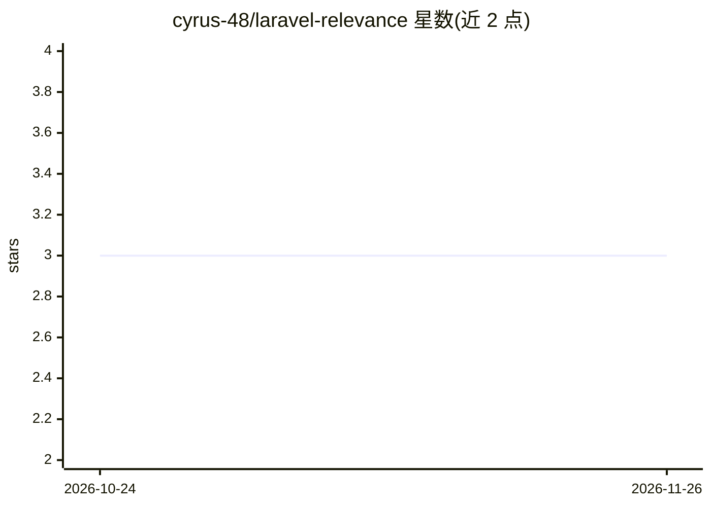

# cyrus-48/laravel-relevance

⭐ 3 · PHP · MIT · 推送 2026-10-16 · [GitHub](https://github.com/cyrus-48/laravel-relevance) · 个人维护

**Laravel 全文/语义混合搜索、推荐与 RAG 检索工具包**

面向 Laravel 框架的搜索与推荐编排扩展包，提供端到端相关性工程流程：事务性 outbox 索引、零停机重建索引、向量嵌入、BM25 与稠密向量的 RRF 混合检索、查询规则与业务信号加权、Item-kNN 协同过滤推荐位、A/B 实验、基于 NDCG@10 的离线评测 CI 门禁、交叉编码器重排、结果多样性控制、多索引联合检索与 RAG 分块检索，并含 GDPR 数据擦除/导出与多租户工具。通过 Composer 安装，以 Artisan CLI 命令和 Eloquent 集成方式使用。

## 筛选速览

| 维度 | 判定 | 备注 |
|---|---|---|
| AI 角色 | `ai-ecosystem` | LLM/agent 周边工具 |
| 许可风险 | `permissive` | MIT |
| 部署形态 | `None` |  |
| 模型依赖 | — | README 未给出锁定关系 |
| 硬件要求 | — | 无带数字的原话,不猜 |
| 安装摩擦 | `low` | 无编译、无系统依赖或容器化 |
| 成熟度 | `idea` | |

## 能力要点

- 混合检索：BM25 词法与稠密向量经 RRF 融合，嵌入服务不可用时自动降级为文本检索
- 零停机索引重建：写入临时物理 generation，别名原子切换
- 离线相关性评测（NDCG@10/MRR/Recall@k/MAP）并可在 CI 中作为部署门禁
- RAG 分块检索 API，含父文档折叠与面向 LLM 的引用元数据

## 适用场景

- 为 Laravel 电商站点搭建混合搜索与个性化推荐
- 在 CI 中卡控搜索排序质量回退（NDCG 门禁）
- 为知识库问答系统提供带引用元数据的分块检索
- 满足 GDPR 的用户行为数据擦除与导出要求

## 场景标签

`RAG` `语义搜索` · 领域:知识与检索

## 证据(README 行号)

> L12: **Laravel Relevance** is an enterprise-grade search and recommendation orchestration toolkit for Laravel. Rather th
> L201: #### RAG Retrieval API
> L211: ### Laravel Scout Compatibility

## 星数曲线

2026-10-24 3 → 2026-11-26 3（+0）

---
*卡片 v1 · prompt 1.4 · 生成 2026-11-22 · 置信度 high · 依据 README sha `9bd351930518` · [字段定义](../../DATASET.md)*
