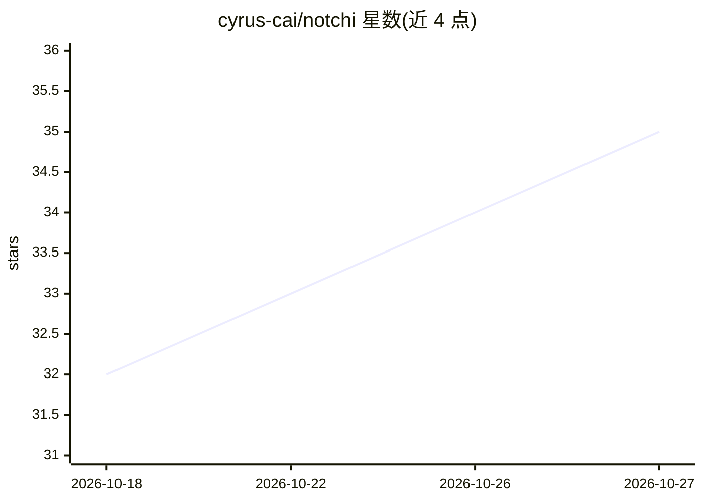

# cyrus-cai/notchi

⭐ 35 · Swift · MIT · 推送 2026-10-26 · [GitHub](https://github.com/cyrus-cai/notchi) · [官网](https://notch.website/) · 个人维护 · 中文 README

**在 MacBook 刘海处记笔记、设提醒、问 AI 的 macOS 应用**

开源 macOS 应用，把 MacBook 刘海（notch）变为输入入口：一行文字可存为 Apple Notes、含时间的行转为 Apple Reminders、问题发给 AI 模型对话（支持联网搜索、读截图、记忆），也可将项目任务交给 Codex/Claude Code 等编码 CLI 后台运行。模型可用 Notchi 自有按量计费通道、自带 API key（OpenRouter/Anthropic/本地 OpenAI 兼容端点等）或已登录的 CLI。支持无刘海 Mac（绘制虚拟刘海），需 macOS 14+。

## 筛选速览

| 维度 | 判定 | 备注 |
|---|---|---|
| AI 角色 | `ai-enhanced` | 去掉 AI 部分产品仍成立 |
| 许可风险 | `permissive` | MIT |
| 部署形态 | `None` |  |
| 模型依赖 | local-ok | 支持本地模型 |
| 硬件要求 | — | 无带数字的原话,不猜 |
| 安装摩擦 | `low` | 无编译、无系统依赖或容器化 |
| 成熟度 | — | 结构信号不足 |

## 能力要点

- 刘海处一行输入分流到 Notes/Reminders/AI 对话
- 后台运行 Codex、Claude Code、Cursor、Grok、pi 等编码 CLI 并显示进度
- 自带 key 支持 OpenRouter/OpenAI/Anthropic/Gemini/DeepSeek 及 Ollama/LM Studio/vLLM 等本地端点
- 本地存储 Notes、提醒、记忆与剪贴板，无注册账号

## 适用场景

- 随手在刘海处记录想法或安排定时提醒
- 不切换窗口直接向 AI 提问并延续对话
- 把软件任务交给编码 agent 在项目文件夹后台执行
- 对任意应用中选中文本运行翻译、润色等提示词

## 场景标签

`AI 助手` · 领域:对话与助手

## 证据(README 行号)

> L9: Save **notes**, set **reminders**, **ask AI**, and **hand tasks to coding agents**, all from your Mac's notch.
> L18: Notchi is a free, open-source macOS app that turns the MacBook notch into a place to type. A thought can become an 

## 星数曲线

2026-10-18 32 → 2026-10-27 35（+3）

---
*卡片 v1 · prompt 1.4 · 生成 2026-10-25 · 置信度 high · 依据 README sha `eb303b168851` · [字段定义](../../DATASET.md)*
