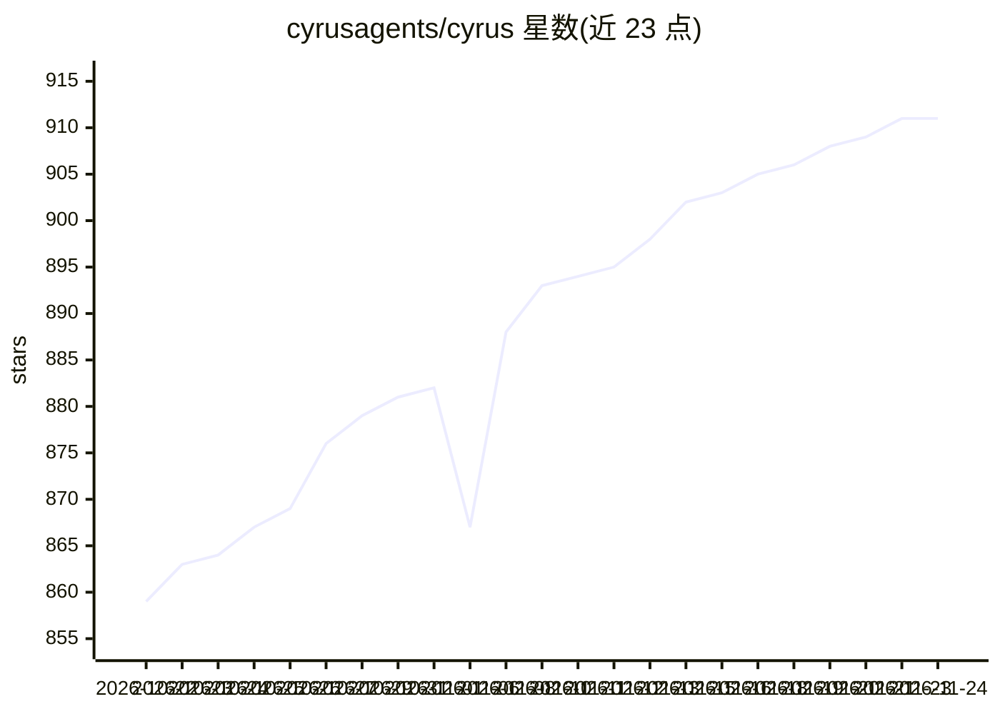

# cyrusagents/cyrus

⭐ 911 · TypeScript · Apache-2.0 · 推送 2026-11-21 · [GitHub](https://github.com/cyrusagents/cyrus) · [官网](https://atcyrus.com) · 组织维护

**部署在自有机器上、由 Linear/Slack 事件驱动的 coding agent 后台运行平台**

Cyrus 监听分配给它的 Linear/GitHub/GitLab/Slack issue，为每个 issue 创建隔离的 Git worktree，在其中运行 Claude Code、Codex、Cursor、Gemini 或 Opencode 会话处理任务，并把 agent 活动流与下拉选择、审批等交互回传到对应平台。采用 BYOK 模式（用户自带 API key/订阅），支持社区全自托管、付费自托管与云托管三种部署方式，持久运行依赖 tmux/pm2/systemd。

## 筛选速览

| 维度 | 判定 | 备注 |
|---|---|---|
| AI 角色 | `ai-ecosystem` | LLM/agent 周边工具 |
| 许可风险 | `permissive` | Apache-2.0 |
| 部署形态 | `library` | 以包/库形式分发 |
| 模型依赖 | locked-api |  |
| 硬件要求 | — | 无带数字的原话,不猜 |
| 安装摩擦 | `low` | 无编译、无系统依赖或容器化 |
| 成熟度 | — | 结构信号不足 |

## 能力要点

- 监听 Linear/GitHub/GitLab/Slack 指派 issue 并自动创建隔离 Git worktree
- 支持 Claude Code、Codex、Cursor、Gemini、Opencode 多种 agent harness
- BYOK：使用用户自带的 key 或订阅
- AI 引导的自托管安装流程（/cyrus-setup skill）

## 适用场景

- 让团队在 Linear 指派 issue 后由后台 agent 自动处理
- 在 Slack 中通过 @mention 触发 coding agent 任务
- 自托管方式在自己机器上运行 agent 并回传 PR/MR

## 场景标签

`编码 Agent` · 领域:编码与开发

## 证据(README 行号)

> L9: Your (Claude Code|Codex|Cursor|Gemini|Opencode) powered (Linear|GitHub|GitLab|Slack) agent. Cyrus monitors (Linear|G
> L37: It is called 'self-hosted' because it uses a machine you control as the agent runtime. Networking layer and integra

## 星数曲线

2026-10-22 859 → 2026-11-24 911（+52）

---
*卡片 v1 · prompt 1.4 · 生成 2026-11-24 · 置信度 high · 依据 README sha `211ac43608e5` · [字段定义](../../DATASET.md)*
