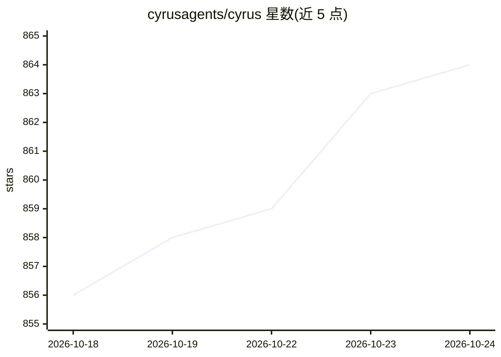

# cyrusagents/cyrus

⭐ 864 · TypeScript · Apache-2.0 · 推送 2026-10-23 · [GitHub](https://github.com/cyrusagents/cyrus) · [官网](https://atcyrus.com) · 组织维护

**接入 Linear/GitHub/GitLab/Slack 的后台编码 agent 部署平台**

Cyrus 监听指派给它的 Linear/GitHub/GitLab/Slack 议题，为每个议题创建隔离的 Git worktree，运行 Claude Code/Codex/Cursor/Gemini/Opencode 会话处理议题，并将 agent 活动更新流式回传到 Linear/GitHub，支持下拉选择与审批等交互。采用 BYOK 模式（自带 token/订阅）。提供零成本全自托管社区版（npx skills 安装、AI 引导配置）与 Pro/Team 付费版（npm 全局安装 cyrus-ai 或云端托管）。

## 筛选速览

| 维度 | 判定 | 备注 |
|---|---|---|
| AI 角色 | `ai-ecosystem` | LLM/agent 周边工具 |
| 许可风险 | `permissive` | Apache-2.0 |
| 部署形态 | `library` | 以包/库形式分发 |
| 模型依赖 | locked-api |  |
| 硬件要求 | — | 无带数字的原话,不猜 |
| 安装摩擦 | `low` | 无编译、无系统依赖或容器化 |
| 成熟度 | — | 结构信号不足 |

## 能力要点

- 监控 Linear/GitHub/GitLab/Slack 议题并自动创建隔离 Git worktree 处理
- 支持 Claude Code/Codex/Cursor/Gemini/Opencode 五种编码 agent 作为运行 harness
- 活动更新回流 Linear/GitHub，含下拉选择与审批交互
- BYOK：使用用户自己的 API key 与订阅

## 适用场景

- 团队把 Linear/GitHub 议题自动交给编码 agent 处理并提 PR
- 在 Slack 中接收 agent 进度更新并做审批
- 自有机器上自托管后台编码 agent

## 场景标签

`编码 Agent` · 领域:编码与开发

## 证据(README 行号)

> L9: Your (Claude Code|Codex|Cursor|Gemini|Opencode) powered (Linear|GitHub|GitLab|Slack) agent. Cyrus monitors (Linear|G
> L17: Zero cost option — host everything yourself with your own Linear OAuth app, GitHub App, and Slack App. An AI-guided

## 星数曲线

2026-10-18 856 → 2026-10-24 864（+8）

---
*卡片 v1 · prompt 1.4 · 生成 2026-10-21 · 置信度 high · 依据 README sha `1f6ff44804f1` · [字段定义](../../DATASET.md)*
