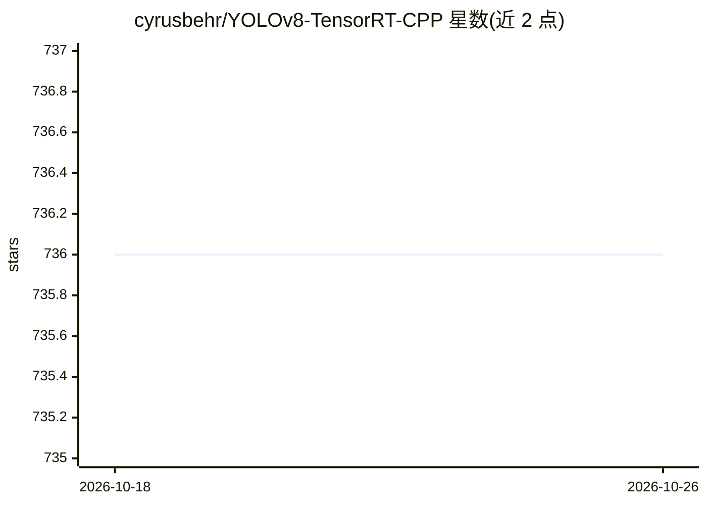

# cyrusbehr/YOLOv8-TensorRT-CPP

⭐ 736 · C++ · MIT · 推送 2026-05-30 · [GitHub](https://github.com/cyrusbehr/YOLOv8-TensorRT-CPP) · 个人维护

**TensorRT C++ 实现 YOLOv8：GPU 上跑检测/分割/姿态估计**

使用 TensorRT C++ API 在 NVIDIA GPU 上运行 YOLOv8 推理的 C++ 工程，支持目标检测、语义分割与人体姿态估计三类模型，后端基于作者的 tensorrt-cpp-api 库。流程为：用 ultralytics 将 PyTorch 权重转 ONNX，首次运行时 TensorRT 生成优化引擎文件，之后可加载缓存引擎；支持 FP16/INT8（INT8 需校准数据）精度，并提供预处理/推理/后处理分量级基准脚本。限制：仅测试 Ubuntu 20.04/22.04，不支持 Windows，需 CUDA、cuDNN、支持 CUDA 的 OpenCV 与 TensorRT ≥10。项目方声明正在寻找维护者。

## 筛选速览

| 维度 | 判定 | 备注 |
|---|---|---|
| AI 角色 | `ai-native` | 本体是模型或模型工具 |
| 许可风险 | `permissive` | MIT |
| 部署形态 | `library` | 以包/库形式分发 |
| 模型依赖 | — | README 未给出锁定关系 |
| 硬件要求 | — | 无带数字的原话,不猜 |
| 安装摩擦 | `high` | 编译与系统依赖俱全 |
| 成熟度 | — | 结构信号不足 |

## 能力要点

- 目标检测、语义分割、姿态估计三种任务开箱即用
- TensorRT 引擎首次生成后缓存，后续运行直接加载
- 支持 FP16 与 INT8 量化推理（INT8 需提供校准数据集）
- 提供预处理/推理/后处理分量基准（RTX 3080 Laptop 实测数据）

## 适用场景

- 在 Ubuntu + NVIDIA GPU 上部署 YOLOv8 检测/分割/姿态推理
- 将 PyTorch YOLOv8 权重转 ONNX 后做 TensorRT 加速
- 对比 FP32/FP16/INT8 精度下的推理耗时

## 场景标签

`目标检测` `推理引擎` · 领域:感知与多模态

## 证据(README 行号)

> L8:  A C++ Implementation of YoloV8 using TensorRT
> L10:  Supports object detection, semantic segmentation, and body pose estimation.
> L29: This project demonstrates how to use the TensorRT C++ API to run GPU inference for YoloV8.

## 星数曲线

2026-10-18 736 → 2026-10-26 736（+0）

---
*卡片 v1 · prompt 1.4 · 生成 2026-10-21 · 置信度 mid · 依据 README sha `78401daaff0f` · [字段定义](../../DATASET.md)*
