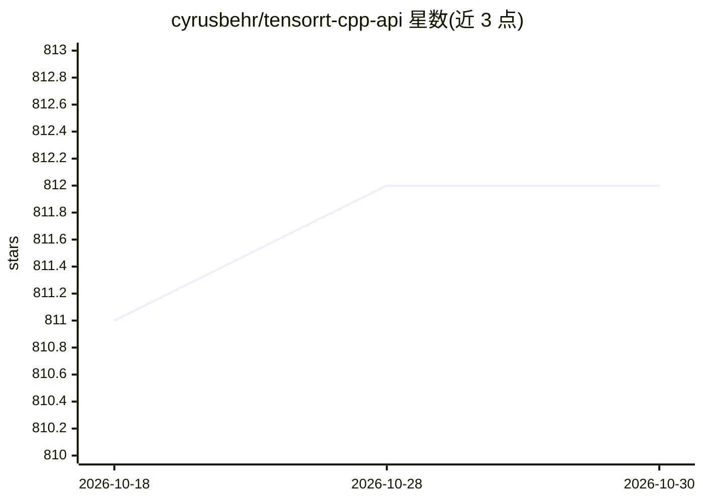

# cyrusbehr/tensorrt-cpp-api

⭐ 812 · C++ · MIT · 推送 2026-05-30 · [GitHub](https://github.com/cyrusbehr/tensorrt-cpp-api) · 个人维护

**面向 C++/Python 的 TensorRT 推理封装库：ONNX 转优化引擎并运行**

一个 no-throw C++ 库，读取 ONNX 模型并构建为缓存的 TensorRT 引擎后执行 CNN 推理：公共头文件不暴露 nvinfer1/OpenCV 类型，提供 name-keyed 张量接口、EnginePool 多流并发、FP16/INT8/FP8 量化、可选单 CUDA kernel 融合预处理与零拷贝 Python 绑定（CuPy/PyTorch/DLPack）。面向需要 GPU 部署视觉模型的 C++/Python 开发者，限 Linux、CUDA 12、TensorRT ≥ 10，CNN 视觉模型范围，Windows 与 LLM/transformer 特性不在范围内。

## 筛选速览

| 维度 | 判定 | 备注 |
|---|---|---|
| AI 角色 | `ai-ecosystem` | LLM/agent 周边工具 |
| 许可风险 | `permissive` | MIT |
| 部署形态 | `library` | 以包/库形式分发 |
| 模型依赖 | — | README 未给出锁定关系 |
| 硬件要求 | — | 无带数字的原话,不猜 |
| 安装摩擦 | `high` | 编译与系统依赖俱全 |
| 成熟度 | — | 结构信号不足 |

## 能力要点

- ONNX→缓存 TensorRT 引擎，缓存按模型哈希/构建选项/TensorRT 版本/GPU UUID 检测失效
- EnginePool 租借执行上下文支持多流并发推理
- 可选零拷贝 Python 绑定 trtcpp，支持 CuPy/PyTorch/Numba GPU 数组
- 可选单 kernel 融合预处理（letterbox/颜色转换/归一化/HWC→NCHW）

## 适用场景

- 在 C++ 生产代码中运行 YOLOv8 等视觉模型的 GPU 推理
- Python 侧直接传入 GPU 张量做零拷贝推理
- 为检测/分割/分类视觉管线构建 TensorRT 后端

## 场景标签

`推理引擎` · 领域:训练与推理

## 证据(README 行号)

> L11:  A modern, no-throw C++ library for high-performance GPU inference of CNN models with NVIDIA TensorRT — with option
> L13: `tensorrt_cpp_api` turns an ONNX model into a cached, optimized TensorRT engine and runs it with

## 星数曲线

2026-10-18 811 → 2026-10-30 812（+1）

---
*卡片 v1 · prompt 1.4 · 生成 2026-10-21 · 置信度 high · 依据 README sha `8b55c6b1b147` · [字段定义](../../DATASET.md)*
