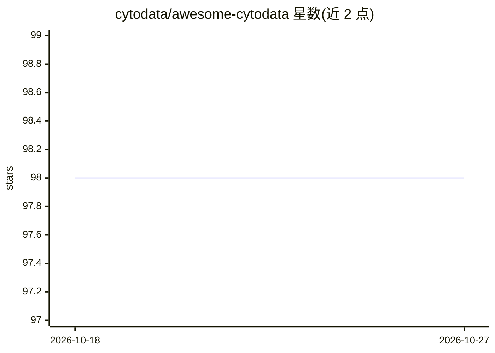

# cytodata/awesome-cytodata

⭐ 98 · TypeScript · CC0-1.0 · 推送 2026-10-09 · [GitHub](https://github.com/cytodata/awesome-cytodata) · 组织维护

**图像分析表型（cytodata）领域的论文/软件/数据集策展网站**

由 CytoData 社区维护的知识聚合站点：集中收录 image-based profiling（多为 Cell Painting 实验）领域的论文、公开数据集与软件工具，提供文献语料库、数据集索引与软件目录三大板块。技术形态为部署在 GitHub Pages 的无服务器静态 Web 应用：React 19 经 CDN 零安装开发，Fuse.js 做客户端模糊搜索，数据以 /data/ 下扁平 JSON 存储，社区通过 add_resource.py 脚本或直接编辑 JSON 后提交 PR 贡献条目。

## 筛选速览

| 维度 | 判定 | 备注 |
|---|---|---|
| AI 角色 | `ai-knowledge` | 知识聚合/清单类 |
| 许可风险 | `viral` | CC0-1.0 |
| 部署形态 | `None` |  |
| 模型依赖 | — | README 未给出锁定关系 |
| 硬件要求 | — | 无带数字的原话,不猜 |
| 安装摩擦 | `low` | 无编译、无系统依赖或容器化 |
| 成熟度 | — | 结构信号不足 |

## 能力要点

- 文献语料库支持标题/作者/摘要的实时模糊搜索与 DOI 直达链接
- 收录 Cell Painting Gallery、JUMP-CP、RxRx 等公开数据集的可筛选索引
- 软件目录按用途分类收录 CellProfiler、DeepProfiler、PyCytominer 等工具
- 扁平 JSON 数据层 + GitHub Actions 自动化校验与部署

## 适用场景

- 新研究者按社区精选的 Influential Papers 入门 image-based profiling
- 查找该领域的公开数据集与标准分析流水线
- 为论文或工具发布提交条目，纳入社区索引

## 场景标签

`精选清单` · 领域:学习与行业

## 证据(README 行号)

> L7: **Awesome CytoData** is a website that collects research papers, software, and datasets related to image-based profi
> L32: - Catalog of community-standard tools including **CellProfiler**, **DeepProfiler**, and **PyCytominer**.

## 星数曲线

2026-10-18 98 → 2026-10-27 98（+0）

---
*卡片 v1 · prompt 1.4 · 生成 2026-10-23 · 置信度 high · 依据 README sha `6b0e9c9bddf9` · [字段定义](../../DATASET.md)*
