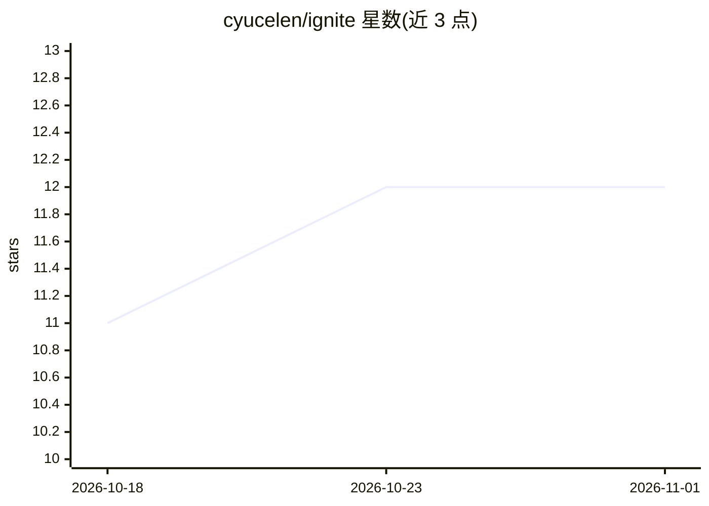

# cyucelen/ignite

⭐ 12 · Go · MIT · 推送 2026-10-21 · [GitHub](https://github.com/cyucelen/ignite) · 个人维护

**面向 AI 代理与自动化流程的按需 Docker 容器 REST API**

自托管的 Go 语言服务，通过简单 REST API 按需创建、查询、停止 Docker 容器，支持自动拉取镜像、GHCR 私有镜像认证、容器生命周期与资源限制配置、WebSocket 实时事件与内置 Web 监控面板，进程退出时自动清理容器。面向需要为 AI 代理（会议机器人、网页抓取、代码沙箱执行）和自动化工作流动态分配临时计算负载的开发者。需本机 Docker 运行，从源码构建需 Go 1.21+，README 中与 Fly.io、AWS Fargate、Kubernetes 做了功能对比表。

## 筛选速览

| 维度 | 判定 | 备注 |
|---|---|---|
| AI 角色 | `ai-ecosystem` | LLM/agent 周边工具 |
| 许可风险 | `permissive` | MIT |
| 部署形态 | `self-host` | docker 或自建部署 |
| 模型依赖 | — | README 未给出锁定关系 |
| 硬件要求 | — | 无带数字的原话,不猜 |
| 安装摩擦 | `low` | 无编译、无系统依赖或容器化 |
| 成熟度 | — | 结构信号不足 |

## 能力要点

- REST API 按需创建/停止容器，自动拉取镜像并缓存
- 细粒度错误码（404/401/429/503/504/507）覆盖拉取失败场景
- WebSocket 实时容器事件与指标（CPU/内存/网络）推送
- 内置 Web UI：实时状态、日志流、容器管理

## 适用场景

- 让 AI 助手按需启动会议机器人或浏览器自动化容器
- 在隔离沙箱中执行不可信的用户提交代码
- 为临时数据处理任务分配自动清理的计算实例

## 场景标签

 · 领域:容器编排/计算基础设施

## 证据(README 行号)

> L3:  Fast, reliable API for on-demand Docker containers
> L22: Run containerized AI agents on-demand for tasks like:
> L26: - **Code executors**: Run untrusted user code safely in sandboxed environments

## 星数曲线

2026-10-18 11 → 2026-11-01 12（+1）

---
*卡片 v1 · prompt 1.4 · 生成 2026-11-01 · 置信度 high · 依据 README sha `d601be715f85` · [字段定义](../../DATASET.md)*
