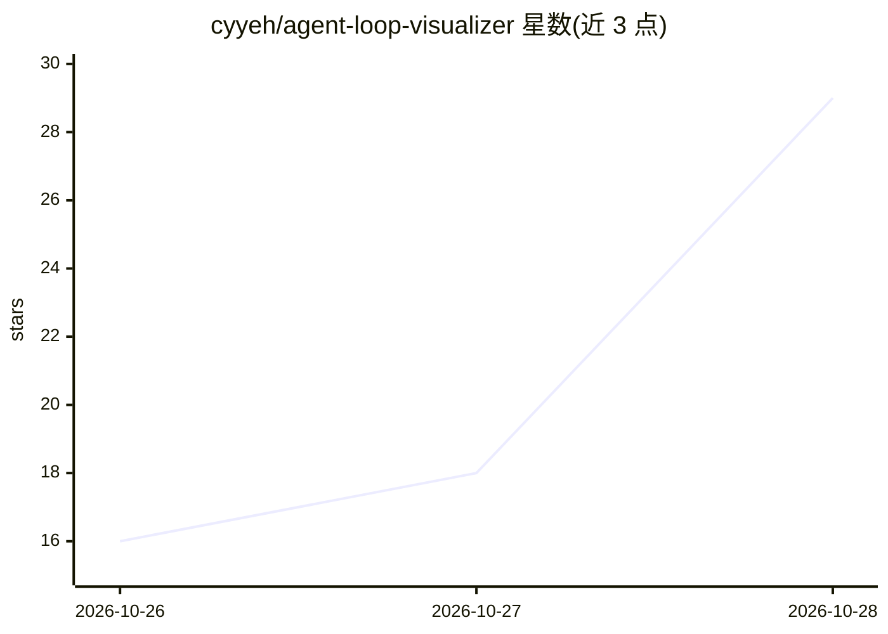

# cyyeh/agent-loop-visualizer

⭐ — · [GitHub]() · 个人维护 · 中文 README

**可视化展示 AI agent 循环内部机制的教学应用**

面向学习者的 Streamlit 交互页面：在本地（Hugging Face transformers）或 vLLM 服务器上运行 Gemma 4 E2B / Qwen3.5 模型，把 agent 循环的每一步（上下文、模型提议动作、harness 执行、环境返回、停止）逐步绘制出来，下探到每个 token 的概率、排名与候选；支持多模态文件输入、可选 run_python Docker 沙箱、MTP 投机解码，以及切换到 pi 作为 harness。页面与 How it works 指南提供英文与繁体中文。限制：需要约 10GB 磁盘放权重，CPU 上运行很慢。

## 筛选速览

| 维度 | 判定 | 备注 |
|---|---|---|
| AI 角色 | `ai-native` | 本体是模型或模型工具 |
| 许可风险 | `permissive` | — |
| 部署形态 | `self-host` | docker 或自建部署 |
| 模型依赖 | local-ok | 支持本地模型 |
| 硬件要求 | `cpu-ok` | |
| 安装摩擦 | `low` | 无编译、无系统依赖或容器化 |
| 成熟度 | — | 结构信号不足 |

## 能力要点

- 逐步可视化 agent 循环，下探到每个 token 的概率/排名/候选与特殊 token
- 模型本地运行（transformers）或经 vLLM（Docker/远程服务器），并支持 MTP 投机解码
- 支持图片/视频/音频多模态输入与可选的 run_python Docker 沙箱代码执行
- 可切换内置 harness 或 pi 作为 harness，How it works 指南代码级映射到 GitHub 源码行

## 适用场景

- 通过可交互的逐步演示理解 agent 循环的工作机制
- 对比不同模型、解码设置与 harness 的行为差异
- 配合 Agent Atlas 课程 Unit 01 阅读材料做实验练习

## 场景标签

`教程课程` · 领域:学习与行业

## 证据(README 行号)

> L7: This project is for learning: it shows how an agent loop works underneath, in a way more intuitive and visual than r
> L17: On the left is a chat like ChatGPT's; on the right the agent loop is drawn step by step: the model reads the contex

## 星数曲线

2026-10-26 16 → 2026-10-28 29（+13）

---
*卡片 v1 · prompt 1.4 · 生成 2026-10-28 · 置信度 mid · 依据 README sha `d534524317f7` · [字段定义](../../DATASET.md)*
