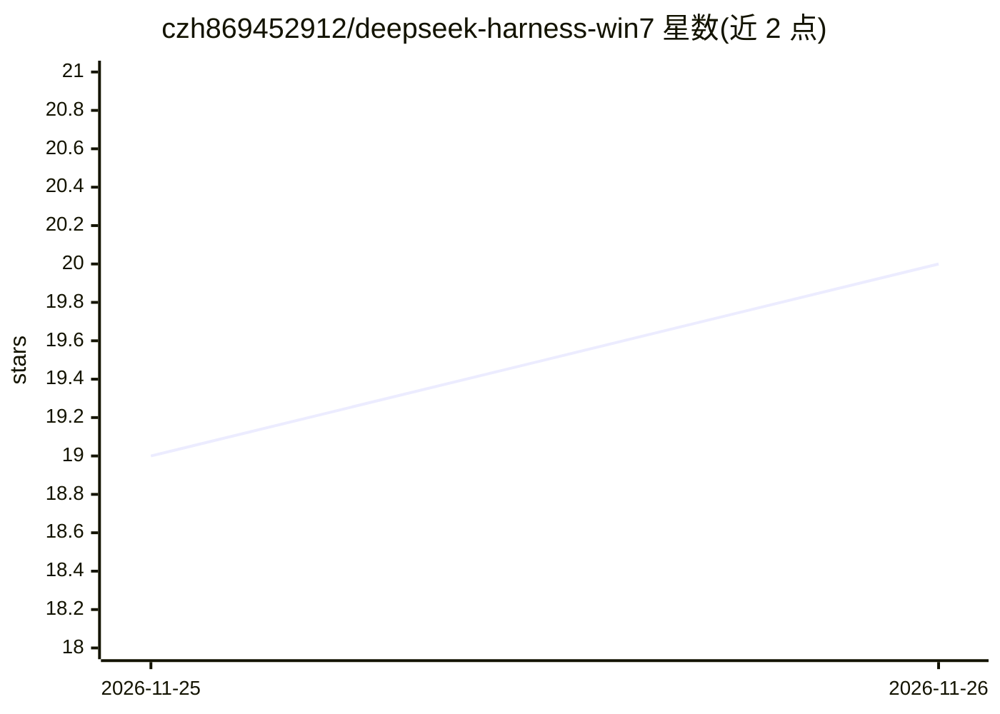

# czh869452912/deepseek-harness-win7

⭐ 20 · TypeScript · 推送 2026-11-24 · [GitHub](https://github.com/czh869452912/deepseek-harness-win7) · [官网](https://github.com/czh869452912/deepseek-harness-win7/releases/latest) · 个人维护 · 中文 README

**DeepSeek Harness 的 Windows 7 Python 移植版，供 Win7 用户运行 AI 编程助手**

将 DeepSeek Harness (DSH) 以 Python 3.8.10 移植到 Windows 7 SP1 及更新的 Windows，作为可在项目目录中读取和编辑文件、运行 Shell 命令、保存会话的 AI 编程助手。提供桌面安装包（Standard/AIO 离线补齐前置组件）、Portable ZIP（自带 Python）和 CLI 三种分发形式，模型凭据支持 DeepSeek API 或 OpenAI 兼容端点。架构上以 Cordis 插件组织，Web 界面复用固定版本的上游 React 前端；创造模式支持 Python Host 与 JavaScript Client 插件。上游采用 MIT 许可证。

## 筛选速览

| 维度 | 判定 | 备注 |
|---|---|---|
| AI 角色 | `ai-native` | 本体是模型或模型工具 |
| 许可风险 | `none` | — |
| 部署形态 | `desktop` | 安装包/桌面程序 |
| 模型依赖 | locked-api |  |
| 硬件要求 | — | 无带数字的原话,不猜 |
| 安装摩擦 | `low` | 无编译、无系统依赖或容器化 |
| 成熟度 | — | 结构信号不足 |

## 能力要点

- 支持 Windows 7 SP1，Desktop AIO 安装包可离线补齐系统前置组件
- 提供桌面应用、Web GUI 和 CLI 三种使用方式
- 以 Cordis 插件架构组织，支持 Python/JavaScript 插件扩展
- 配置 DeepSeek API 或 OpenAI 兼容端点即可使用

## 适用场景

- 在 Windows 7 旧机器上运行 AI 编程助手
- 通过 CLI 无头模式执行项目检查任务
- 以插件方式扩展 AI 助手的工具能力

## 场景标签

`编码 Agent` · 领域:编码与开发

## 证据(README 行号)

> L3: **DeepSeek Harness Win7（DSH Win7）** 是 DeepSeek Harness 的非官方 Python 3.8.10 移植，面向 Windows 7 SP1 及更新的 Windows。它是可在项目目录中
> L23: 在桌面或 Web 设置中配置模型提供商和 API Key，选择一个工作区即可开始。用户可使用 DeepSeek API，也可按提供商设置配置 OpenAI 兼容端点。通过终端启动时，可以在当前 PowerShell 会话中设置 D
> L45: - **极简模式（Minimal）** 提供编辑器和持久 Shell。**标准模式（Standard）** 提供文件、搜索、Shell、技能、规划和子智能体等工程工具。

## 星数曲线

2026-11-25 19 → 2026-11-26 20（+1）

---
*卡片 v1 · prompt 1.4 · 生成 2026-11-24 · 置信度 high · 依据 README sha `9d32904aa1ff` · [字段定义](../../DATASET.md)*
