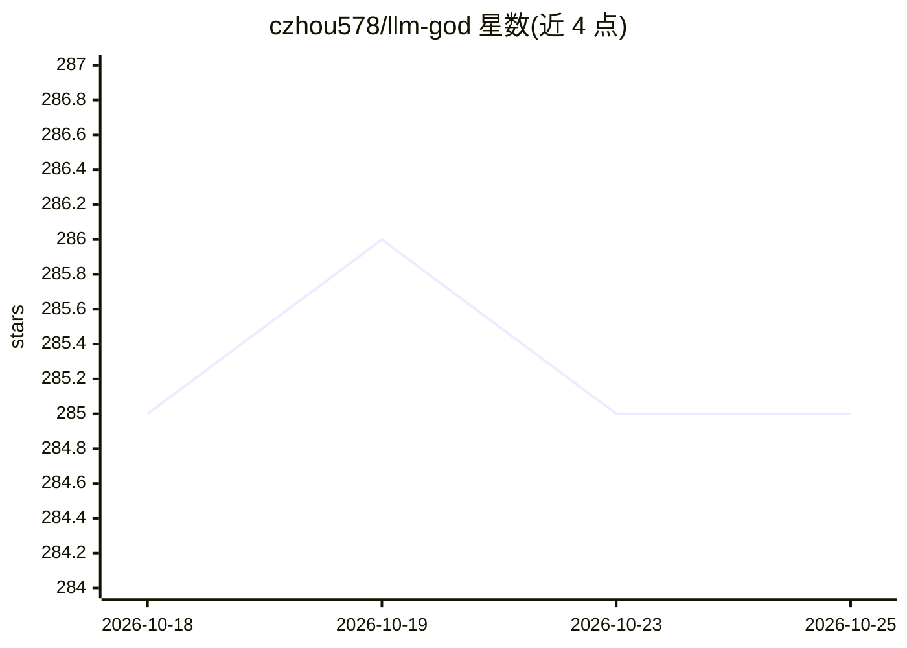

# czhou578/llm-god

⭐ 285 · TypeScript · MIT · 推送 2026-10-17 · [GitHub](https://github.com/czhou578/llm-god) · 个人维护

**同时向多个 LLM 网页界面发送同一提示的 Windows 桌面客户端**

基于 Electron/TypeScript 的 Windows 桌面应用（Linux 版测试中，Mac 已打包未测试）：在多分页视图内同时嵌入 ChatGPT、Gemini、Claude、Grok、DeepSeek、Copilot 等 LLM 网页控制台，一次输入（Ctrl+Enter）将提示广播到所有模型，支持粘贴文本与截图、可保存的自定义提示词。需事先登录各 LLM 网页账号，走各服务原有免费/付费额度限制，非 API 接入。通过 Releases 下载 Setup.exe 安装。

## 筛选速览

| 维度 | 判定 | 备注 |
|---|---|---|
| AI 角色 | `ai-ecosystem` | LLM/agent 周边工具 |
| 许可风险 | `permissive` | MIT |
| 部署形态 | `desktop` | 安装包/桌面程序 |
| 模型依赖 | — | README 未给出锁定关系 |
| 硬件要求 | — | 无带数字的原话,不猜 |
| 安装摩擦 | `low` | 无编译、无系统依赖或容器化 |
| 成熟度 | `idea` | |

## 能力要点

- 一条提示同时发送到多个 LLM 网页界面
- 支持粘贴截图到提示区（12/21 更新，全部模型）
- 下拉菜单增删 LLM 控制台，支持自定义可保存提示词
- TypeScript 迁移、单元测试、多平台构建工作流、深色模式

## 适用场景

- 对比多个大模型对同一问题的回答，省去复制粘贴
- 编码或写作时同时咨询多家 LLM
- 保存常用自定义提示词快速复用

## 场景标签

`聊天机器人` · 领域:对话与助手

## 证据(README 行号)

> L7: This is a desktop app for Windows machines only\* that allows users to simultaneously prompt multiple LLM's at once 
> L11: Currently, the following LLM web interfaces are supported:

## 星数曲线

2026-10-18 285 → 2026-10-25 285（+0）

---
*卡片 v1 · prompt 1.4 · 生成 2026-10-22 · 置信度 mid · 依据 README sha `298888f5c235` · [字段定义](../../DATASET.md)*
