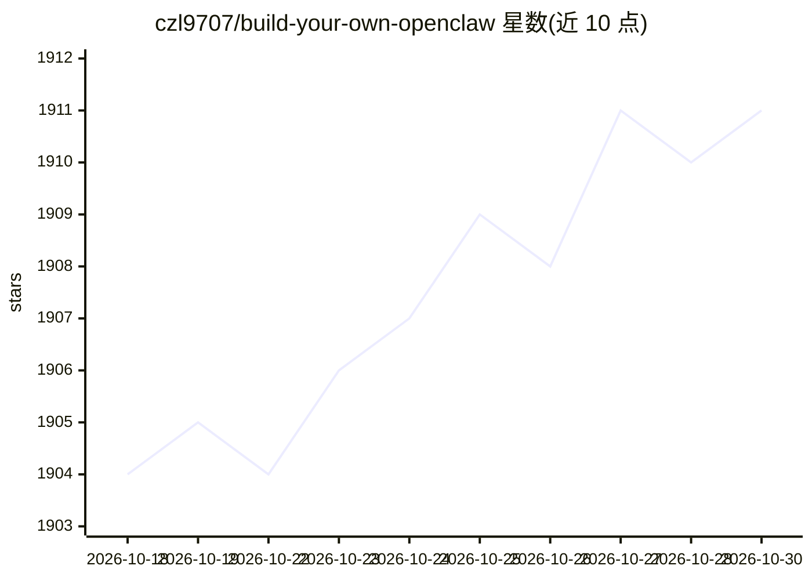

# czl9707/build-your-own-openclaw

⭐ 1,911 · Python · MIT · 推送 2026-07-08 · [GitHub](https://github.com/czl9707/build-your-own-openclaw) · [官网](https://build-your-own-openclaw.kiyo-n-zane.com/) · 个人维护

**分 18 步从零构建 AI agent 的教程与可运行代码**

面向学习者的渐进式教程：通过 18 个步骤从最简单的聊天循环开始，逐步构建一个 OpenClaw 的精简版本，每步附讲解 README 与可运行代码，参考实现为 pickle-bot。内容分四阶段：单一 agent（工具/技能/持久化/Web 工具）、事件驱动架构（热重载/多渠道/WebSocket）、自主与多 agent（路由/定时任务/调度）、生产化（并发控制/长期记忆）。运行前需复制示例配置并填写 API key，支持 LiteLLM 列出的多个模型提供商。

## 筛选速览

| 维度 | 判定 | 备注 |
|---|---|---|
| AI 角色 | `ai-knowledge` | 知识聚合/清单类 |
| 许可风险 | `permissive` | MIT |
| 部署形态 | `None` |  |
| 模型依赖 | — | README 未给出锁定关系 |
| 硬件要求 | — | 无带数字的原话,不猜 |
| 安装摩擦 | `low` | 无编译、无系统依赖或容器化 |
| 成熟度 | — | 结构信号不足 |

## 能力要点

- 18 个渐进步骤，每步含讲解 README 与可运行代码
- 四阶段结构：单 agent、事件驱动、多 agent、生产化
- 参考实现项目 pickle-bot
- 通过 config.user.yaml 配置 API key，支持 LiteLLM 提供商列表

## 适用场景

- 系统学习 AI agent 从聊天循环到多 agent 的构建方法
- 跟随步骤获得可运行的最小 agent 实现作参考
- 了解事件驱动与多 agent 架构的改造思路

## 场景标签

`教程课程` · 领域:学习与行业

## 证据(README 行号)

> L3: A step-by-step tutorial to build your own AI agent, from a simple chat loop to a lightweight version of OpenClaw.
> L7: **18 progressive steps** that teach you how to build an minimal version of OpenClaw. Each step includes:

## 星数曲线

2026-10-18 1,904 → 2026-10-30 1,911（+7）

---
*卡片 v1 · prompt 1.4 · 生成 2026-10-21 · 置信度 high · 依据 README sha `f087a22cc077` · [字段定义](../../DATASET.md)*
