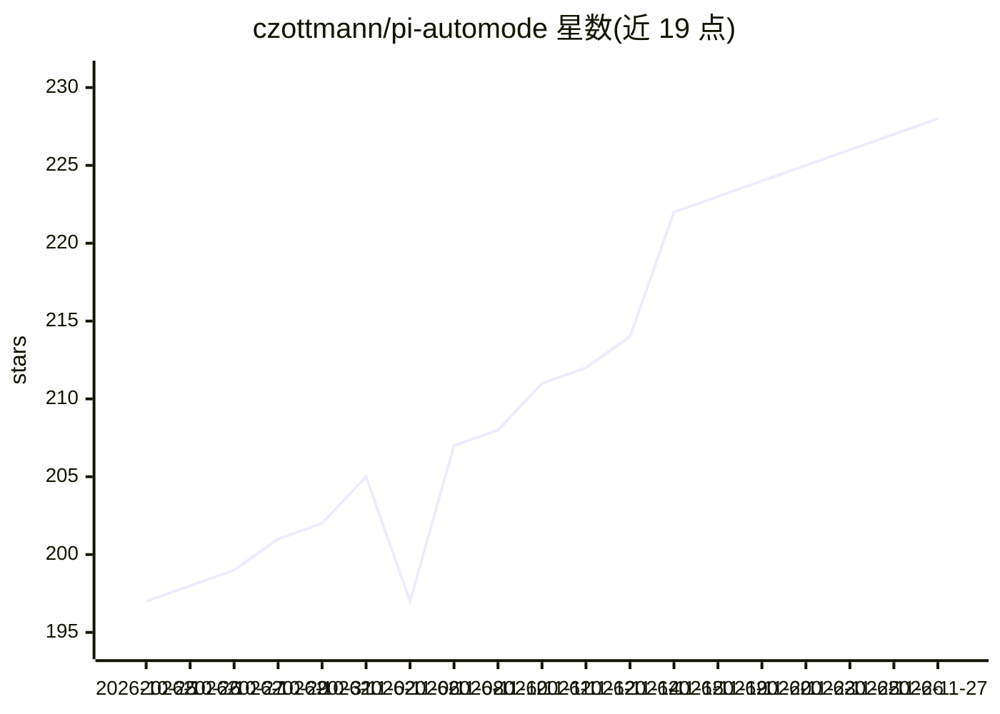

# czottmann/pi-automode

⭐ 228 · TypeScript · MIT · 推送 2026-11-17 · [GitHub](https://github.com/czottmann/pi-automode) · [官网](https://npmx.dev/package/@czottmann/pi-automode) · 个人维护

**为 Pi 编码 agent 提供 Claude Code 式自动模式的守门扩展**

运行在 Pi / Oh My Pi 18 上的守卫扩展：在 agent 工具调用执行前拦截，按权限拒绝规则、确定性硬拒检查（shell 配置写入、SSH authorized_keys、持久化、破坏性删除等）与本地分类器决策三层依次判定是否放行，并提供 /automode 开关、TUI 状态行、只读诊断工具与诊断 skill。明确声明不是沙箱，不守卫用户手动 shell 命令，不能作为 OS 安全边界。

## 筛选速览

| 维度 | 判定 | 备注 |
|---|---|---|
| AI 角色 | `ai-ecosystem` | LLM/agent 周边工具 |
| 许可风险 | `permissive` | MIT |
| 部署形态 | `None` |  |
| 模型依赖 | — | README 未给出锁定关系 |
| 硬件要求 | — | 无带数字的原话,不猜 |
| 安装摩擦 | `low` | 无编译、无系统依赖或容器化 |
| 成熟度 | — | 结构信号不足 |

## 能力要点

- 三层拦截：权限规则→确定性硬拒→分类器决策
- 确定性硬拒覆盖 shell profile、SSH authorized_keys、cron/服务持久化等写入
- 只读诊断工具 automode_inspect 与内置 automode-diagnostics skill
- Bash 结构解析（unbash）与 schema 约束采样、本地校验工具调用

## 适用场景

- 让 Pi agent 自主执行工具时减少危险操作
- 按项目配置定制权限允许/拒绝规则
- 通过状态行与诊断工具排查自动模式的拦截决策

## 场景标签

`编码 Agent` · 领域:编码与开发

## 证据(README 行号)

> L5: This is a guardrail extension. It intercepts agent tool calls before execution and blocks actions that match permiss
> L13: Pi-automode supports Pi and Oh My Pi (OMP) 18. It automatically uses OMP's legacy completion API. The integration n

## 星数曲线

2026-10-25 197 → 2026-11-27 228（+31）

---
*卡片 v1 · prompt 1.4 · 生成 2026-11-25 · 置信度 high · 依据 README sha `0b0722f23cdf` · [字段定义](../../DATASET.md)*
