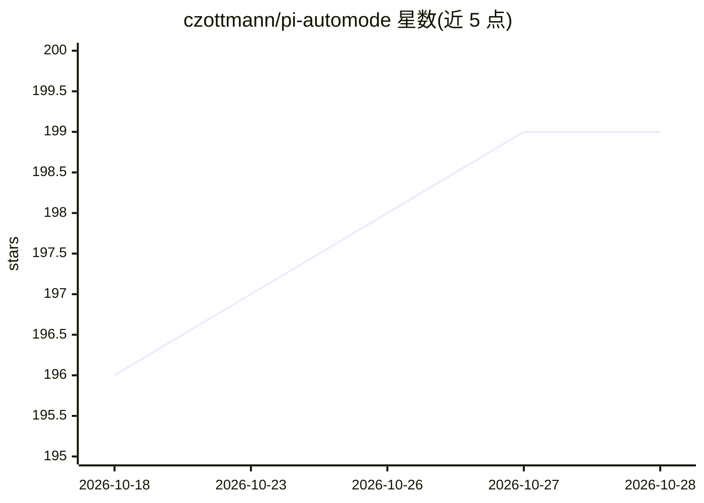

# czottmann/pi-automode

⭐ 201 · TypeScript · MIT · 推送 2026-09-25 · [GitHub](https://github.com/czottmann/pi-automode) · [官网](https://npmx.dev/package/@czottmann/pi-automode) · 个人维护

**Pi/OMP 的 Claude Code 式 auto 模式守卫扩展**

面向 Pi 与 Oh My Pi 18 的防护型扩展：在 agent 工具调用执行前拦截，按权限拒绝规则、确定性硬拒绝检查（SSH authorized_keys、cron 持久化、TLS 削弱、破坏性删除等）及分类器决策放行或阻断动作。分类器采用本地提示词实现两阶段判定（保守 token 过滤 + 嵌套工具调用），未复现 Claude Code 私有分类器。声明非沙箱、不防护用户 shell 命令，不作 OS 安全边界。附状态栏、只读诊断工具 automode_inspect 与诊断 skill。通过 npm 或本地 checkout 安装。

## 筛选速览

| 维度 | 判定 | 备注 |
|---|---|---|
| AI 角色 | `ai-ecosystem` | LLM/agent 周边工具 |
| 许可风险 | `permissive` | MIT |
| 部署形态 | `None` |  |
| 模型依赖 | — | README 未给出锁定关系 |
| 硬件要求 | — | 无带数字的原话,不猜 |
| 安装摩擦 | `low` | 无编译、无系统依赖或容器化 |
| 成熟度 | — | 结构信号不足 |

## 能力要点

- 执行前拦截 agent 工具调用，含确定性硬拒绝检查清单
- 两阶段分类器：token 过滤 + 嵌套 classifier_decision 工具调用
- 基于 unbash 的 Bash AST 解析，解析错误即阻断
- 状态栏显示允许/拒绝/分类器计数，附只读诊断工具与 skill

## 适用场景

- 在 Pi/OMP 中降低 agent 自主工具调用的不安全行为
- 按项目配置 deniedPaths 与权限规则限制敏感路径访问
- 查看 auto 模式状态与拒绝记录进行诊断

## 场景标签

`网络安全` · 领域:学习与行业

## 证据(README 行号)

> L3: Claude Code-style auto mode for Pi.
> L5: This is a guardrail extension. It intercepts agent tool calls before execution and blocks actions that match permiss
> L13: Pi-automode supports Pi and Oh My Pi (OMP) 18. It automatically uses OMP's legacy completion API. The integration n

## 星数曲线

2026-10-18 196 → 2026-10-28 199（+3）

---
*卡片 v1 · prompt 1.4 · 生成 2026-10-22 · 置信度 high · 依据 README sha `d4b2d486714a` · [字段定义](../../DATASET.md)*
