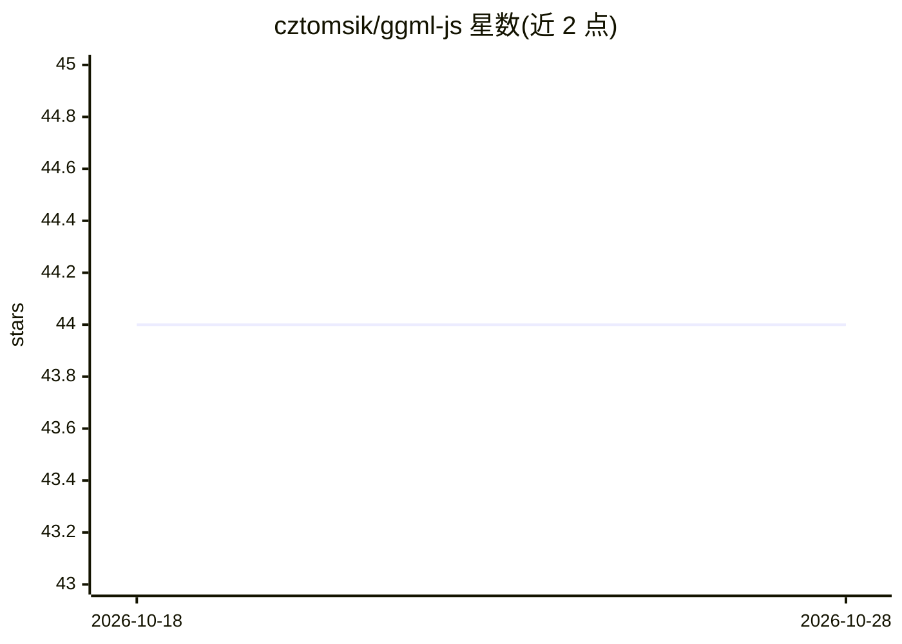

# cztomsik/ggml-js

⭐ 44 · JavaScript · MIT · 推送 2025-11-10 · [GitHub](https://github.com/cztomsik/ggml-js) · 个人维护

**GGML 张量库的 JavaScript 绑定，供 JS 中运行 ML 模型**

为 C 实现的张量/机器学习库 GGML 提供 JavaScript/Node.js 绑定，暴露 Context、张量运算等核心 API，并提供加载预训练模型与分词器的模块（如 RWKV 模型、BPETokenizer）。面向希望在 JavaScript 代码中直接使用 GGML 能力的开发者。通过 npm 安装，从源码构建使用 zig build。项目声明暂时处于 on hold 状态，作者转向开发 Ava Personal Language Server。

## 筛选速览

| 维度 | 判定 | 备注 |
|---|---|---|
| AI 角色 | `ai-ecosystem` | LLM/agent 周边工具 |
| 许可风险 | `permissive` | MIT |
| 部署形态 | `library` | 以包/库形式分发 |
| 模型依赖 | — | README 未给出锁定关系 |
| 硬件要求 | — | 无带数字的原话,不猜 |
| 安装摩擦 | `low` | 无编译、无系统依赖或容器化 |
| 成熟度 | — | 结构信号不足 |

## 能力要点

- JavaScript 绑定 GGML 张量运算库（Context、张量乘法等 API）
- 提供 RWKV 模型与 BPETokenizer 预训练模型/分词器模块
- npm 安装，源码构建使用 zig build

## 适用场景

- 在 Node.js 中加载并运行 RWKV 等 GGML 模型
- 在 JavaScript 代码中执行 GGML 张量运算

## 场景标签

 · 领域:机器学习库/JS 绑定

## 证据(README 行号)

> L6: JavaScript bindings for the GGML library, a
> L7: fast and lightweight tensor/machine-learning library implemented in C.

## 星数曲线

2026-10-18 44 → 2026-10-28 44（+0）

---
*卡片 v1 · prompt 1.4 · 生成 2026-10-25 · 置信度 high · 依据 README sha `306975c4e8af` · [字段定义](../../DATASET.md)*
