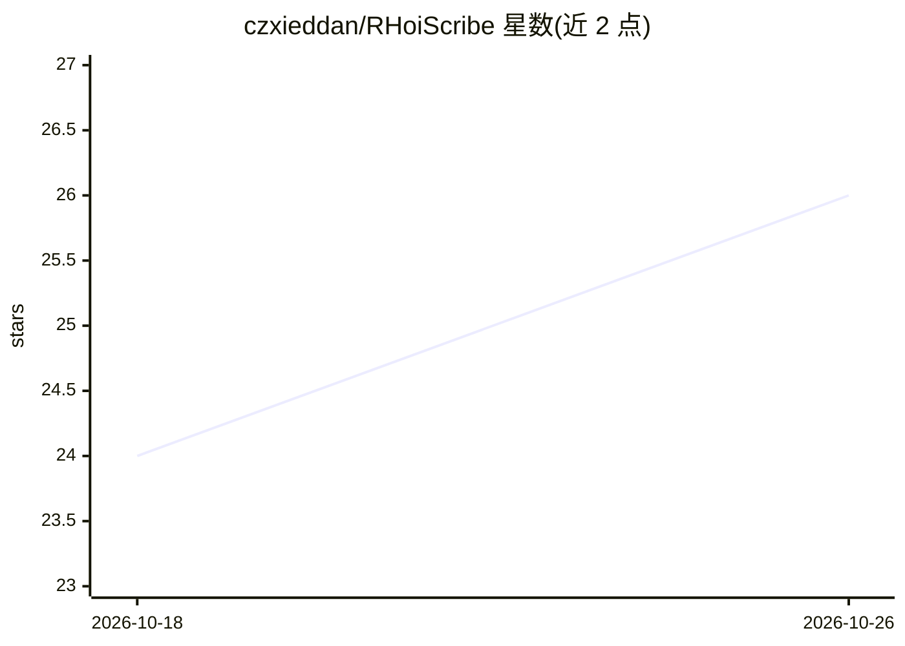

# czxieddan/RHoiScribe

⭐ 26 · Rust · AGPL-3.0 · 推送 2026-10-10 · [GitHub](https://github.com/czxieddan/RHoiScribe) · 个人维护 · 中文 README

**面向 HOI4 模组 agent 的本地 MCP 服务器与 SKILL 包**

为 Codex、Claude Code 等 MCP 兼容客户端提供本地钢铁雄心4模组开发参考层与工具：内置 HOI4 知识、可复用 prompts 与面向文件的工具，覆盖项目结构认知、基于 cwtools 的语言支持、交付前红黄绿加载风险检查、编码与格式检查、安全编辑既有文件、调试启动准备、工具调用审计日志及实验性 GUI/GFX 资产生成。以 Rust 实现、MCP over stdio 传输，运行期无需网络；提供 Windows/Linux/macOS 预编译二进制、Skill 包与源码构建。Skill 支持已标注将逐步淘汰。

## 筛选速览

| 维度 | 判定 | 备注 |
|---|---|---|
| AI 角色 | `ai-ecosystem` | LLM/agent 周边工具 |
| 许可风险 | `viral` | AGPL-3.0 |
| 部署形态 | `desktop` | 安装包/桌面程序 |
| 模型依赖 | — | README 未给出锁定关系 |
| 硬件要求 | — | 无带数字的原话,不猜 |
| 安装摩擦 | `medium` | 含编译或系统依赖之一 |
| 成熟度 | — | 结构信号不足 |

## 能力要点

- MCP over stdio 的本地服务器，运行期无需网络
- 基于 cwtools 的 HOI4 语言支持与红黄绿加载风险检查
- RNMDB 支撑的跨 IDE agent 状态与工具调用审计日志
- Windows/Linux/macOS 预编译二进制与 Skill 包两种接入方式

## 适用场景

- 让 AI agent 在本地离线环境下生成可加载的 HOI4 模组内容
- 模组团队要求生成内容遵循可预测的路径与可审查的输出
- 减少 agent 重复网页搜索与过时假设导致的返工

## 场景标签

`编码 Agent` · 领域:编码与开发

## 证据(README 行号)

> L16: RHoiScribe gives Codex, Claude Code, and other MCP-compatible clients a local HOI4 modding reference layer plus too
> L52: RHoiScribe gives agents a local HOI4 knowledge layer, reusable prompts, and file-oriented tools for common modding 

## 星数曲线

2026-10-18 24 → 2026-10-26 26（+2）

---
*卡片 v1 · prompt 1.4 · 生成 2026-10-26 · 置信度 high · 依据 README sha `e32afd16c0d4` · [字段定义](../../DATASET.md)*
