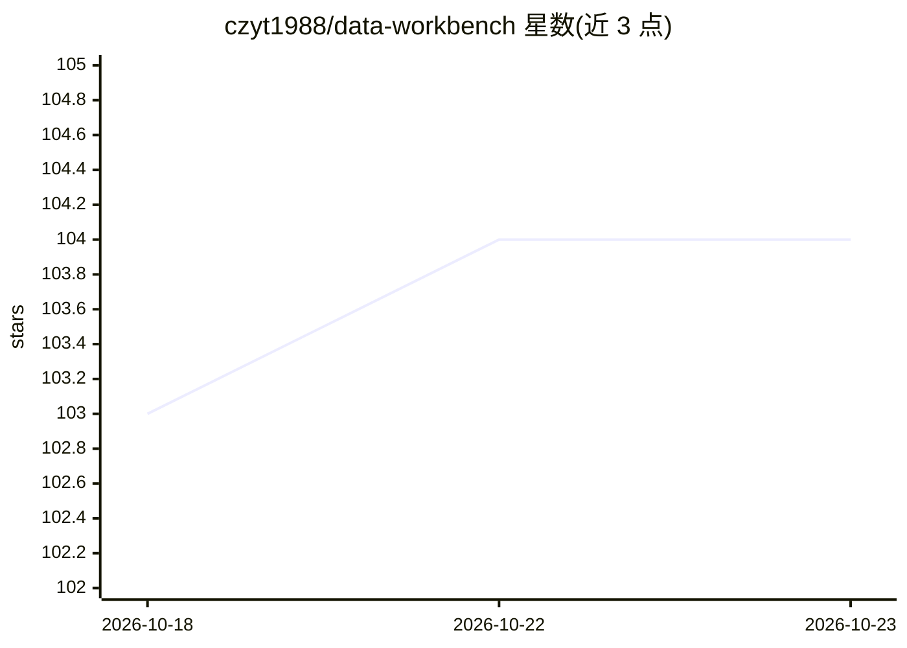

# czyt1988/data-workbench

⭐ 104 · C++ · LGPL-3.0 · 推送 2026-10-18 · [GitHub](https://github.com/czyt1988/data-workbench) · 个人维护 · 中文 README

**AI Agent 驱动的 C++/Qt 数据分析工作台，含工作流与高性能绘图**

基于 C++17/Qt 的插件化桌面数据分析平台，内嵌 Python（pandas/numpy），由五大模块组成：Agent、Workflow 引擎、Data、Chart 与插件接口。内置 AI Agent 基于 LangGraph 构建，默认提供 19 个工具，可用自然语言操作 GUI 完成数据读取、统计、绘图、标注与报告生成；Agent 与 C++ 界面通过进程间通信交互（每个会话独立 Python 进程）。支持有向图工作流（Python 定义节点）、亿级曲线渲染、交互式图表细调与矢量导出，提供 C++ 与 Python 双插件体系。需从源码编译并拉取 git submodule 第三方库。

## 筛选速览

| 维度 | 判定 | 备注 |
|---|---|---|
| AI 角色 | `ai-enhanced` | 去掉 AI 部分产品仍成立 |
| 许可风险 | `viral` | LGPL-3.0 |
| 部署形态 | `library` | 以包/库形式分发 |
| 模型依赖 | — | README 未给出锁定关系 |
| 硬件要求 | — | 无带数字的原话,不猜 |
| 安装摩擦 | `medium` | 含编译或系统依赖之一 |
| 成熟度 | — | 结构信号不足 |

## 能力要点

- 内置 Agent 默认 19 个工具，自然语言驱动真实 GUI 对象操作图表与数据
- 有向图工作流引擎（Python 逻辑层 + QGraphicsView 节点编辑器）
- 亿级曲线渲染与交互式图表细调，导出 PNG/PDF/SVG
- C++ 与 Python 双插件体系，@NodeDef 装饰器注册工作流节点

## 适用场景

- 实验室固定流程数据清洗分析，换数据一键重跑工作流
- 让 AI Agent 自动绘图、出报告，人工再接手微调
- 十万行以上数据的交互式统计绘图与论文级图导出

## 场景标签

`数据分析` `工作流自动化` `GUI 自动化` · 领域:效率与自动化

## 证据(README 行号)

> L7: `DAWorkbench` 是一款由 AI Agent 驱动的数据分析工作平台，采用插件化设计，界面层基于 C++ 实现，具备高性能渲染能力，能够流畅绘制亿级曲线图并展示亿行级数据表格。平台内嵌 `Python` 环境（`panda
> L9: 平台内置可直接操作软件的 AI Agent，通过插件注入工具层为 Agent 提供操作能力，默认提供 19 个工具。用户可用自然语言对话驱动 Agent 直接操作 GUI，完成数据读取、统计计算、绘图、标注添加和分析报告生成等任务。
> L11: 软件核心由五大模块组成：`Agent 模块`、`Workflow 引擎`、`Data 数据处理`、`Chart 可视化`及`插件接口模块`。各模块能力互通，支持 Python 双向操作。`插件接口模块`同时支持纯 Python 插

## 星数曲线

2026-10-18 103 → 2026-10-23 104（+1）

---
*卡片 v1 · prompt 1.4 · 生成 2026-10-23 · 置信度 mid · 依据 README sha `98aba7e2bd12` · [字段定义](../../DATASET.md)*
