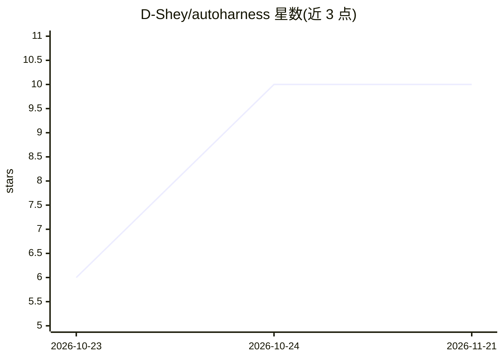

# D-Shey/autoharness

⭐ 10 · Python · MIT · 推送 2026-11-20 · [GitHub](https://github.com/D-Shey/autoharness) · 个人维护

**给编码 agent 加工程纪律的 CLI：先备料、对照原始、独立评审**

AutoHarness 是一个与编码 agent 协同工作的 CLI 工具：agent 负责思考与产出，autoharness CLI 负责强制流程顺序——先分析任务、搜索 skills.sh 与官方 MCP registry 挑选技能和工具、记录 brief，再做信任检查（trust score、危险模式扫描、约束核验）后安装，最后由未参与工作的独立 critic subagent 评审并给出 met/partial/missing 判定。每个命令以 JSON 返回 next 指引，exit code 3 表示需询问用户。支持 light/full/reviewed 三种模式，以 Python 实现，MIT 许可。

## 筛选速览

| 维度 | 判定 | 备注 |
|---|---|---|
| AI 角色 | `ai-ecosystem` | LLM/agent 周边工具 |
| 许可风险 | `permissive` | MIT |
| 部署形态 | `None` |  |
| 模型依赖 | — | README 未给出锁定关系 |
| 硬件要求 | — | 无带数字的原话,不猜 |
| 安装摩擦 | `low` | 无编译、无系统依赖或容器化 |
| 成熟度 | — | 结构信号不足 |

## 能力要点

- CLI 强制流程：未记录 brief 前禁止改动，20 次无 critic 编辑后停止编辑
- MCP 服务器信任评分与 skill 危险模式扫描（~/.ssh、curl|sh 等）
- 独立 critic subagent 评审，带 ANSWER-ID 防止 softened 复述替代原始答案
- 眼判类工作的盲评对比（A/B 名称由 autoharness 保密）

## 适用场景

- 让 Claude Code/Codex 等 agent 在做 API 集成、测试、建站任务前先搜集方法与参考
- 为 agent 安装 MCP 服务器与技能时做信任与约束把关
- 在绘画/设计类任务中用盲评机制防止结果倒退

## 场景标签

`编码 Agent` · 领域:编码与开发

## 证据(README 行号)

> L16: AutoHarness keeps an agent from taking on a task unprepared. The agent works out what the task needs,
> L50: agent decides what the task needs and whether the result is good. The `autoharness` CLI searches

## 星数曲线

2026-10-23 6 → 2026-11-21 10（+4）

---
*卡片 v1 · prompt 1.4 · 生成 2026-11-20 · 置信度 high · 依据 README sha `8916cf7b4308` · [字段定义](../../DATASET.md)*
