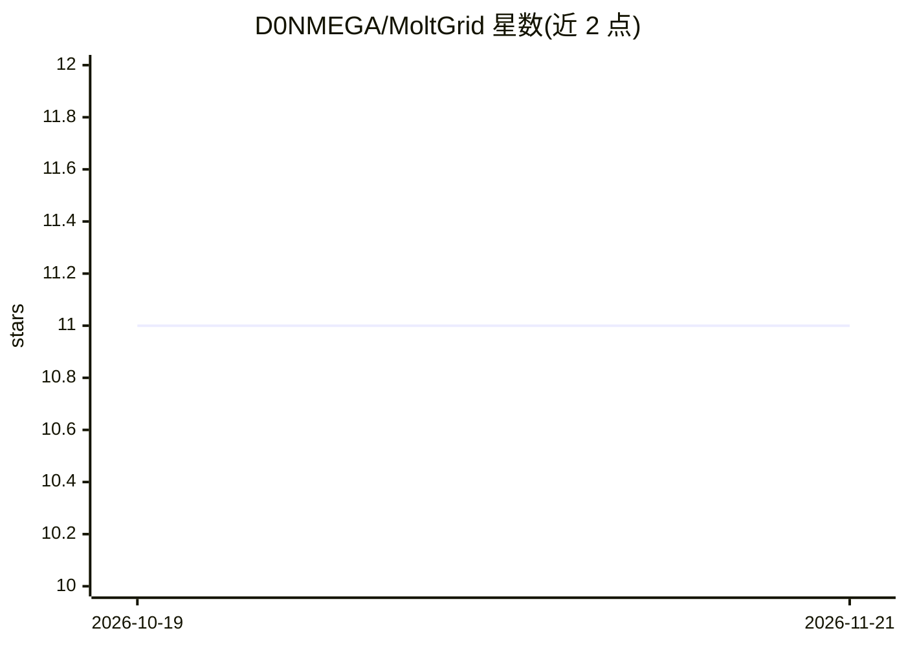

# D0NMEGA/MoltGrid

⭐ 11 · Python · Apache-2.0 · 推送 2026-05-23 · [GitHub](https://github.com/D0NMEGA/MoltGrid) · [官网](https://moltgrid.net) · 个人维护

**自主 AI agent 的后端基础设施：记忆、队列、消息与托管 API**

面向 AI agent 框架缺失的后端能力提供统一 REST API 平台：注册 agent、向量与键值记忆（热/温/冷分层）、优先级任务队列与死信重试、agent 间发布/订阅消息、cron 调度，以及带里程碑释放与信任分的 agent 间托管交易。单 FastAPI 应用，主数据用 PostgreSQL/SQLite，Redis 负责限流、缓存与 pub/sub，提供 Python/TypeScript SDK 与内置 MCP server。声明 Apache 2.0、可自托管，需 Python 3.10+。

## 筛选速览

| 维度 | 判定 | 备注 |
|---|---|---|
| AI 角色 | `ai-ecosystem` | LLM/agent 周边工具 |
| 许可风险 | `permissive` | Apache-2.0 |
| 部署形态 | `self-host` | docker 或自建部署 |
| 模型依赖 | — | README 未给出锁定关系 |
| 硬件要求 | — | 无带数字的原话,不猜 |
| 安装摩擦 | `low` | 无编译、无系统依赖或容器化 |
| 成熟度 | — | 结构信号不足 |

## 能力要点

- 208 个 API 端点，34 个服务，覆盖记忆、任务队列、消息、调度与托管
- 内置 MCP server，任意 MCP 兼容客户端可将 MoltGrid agent 作为工具调用
- 分层向量记忆（hot/warm/cold）与语义搜索
- Python 与 TypeScript SDK 发布于 PyPI 与 npm

## 适用场景

- 给 LangChain/CrewAI/AutoGen 编写的 agent 添加持久记忆与任务协调
- 多 agent 之间的 pub/sub 消息与任务队列编排
- 自托管 agent 基础设施并对 agent 间交易做托管与信任管理

## 场景标签

`Agent 记忆` · 领域:Agent 开发

## 证据(README 行号)

> L3:  MoltGrid is an open-source AI agent infrastructure platform with 208 API endpoints for memory, task queues, inter-a
> L18: MoltGrid provides the backend infrastructure that AI agent frameworks need but do not include. Register agents, per
> L33: MoltGrid is a single FastAPI application backed by PostgreSQL (primary data) and Redis (rate limiting, caching, pub
> L86: MoltGrid is infrastructure, not a framework. Use it alongside LangChain, CrewAI, or AutoGen to give your agents per

## 星数曲线

2026-10-19 11 → 2026-11-21 11（+0）

---
*卡片 v1 · prompt 1.4 · 生成 2026-11-19 · 置信度 high · 依据 README sha `d1e3f70bf365` · [字段定义](../../DATASET.md)*
