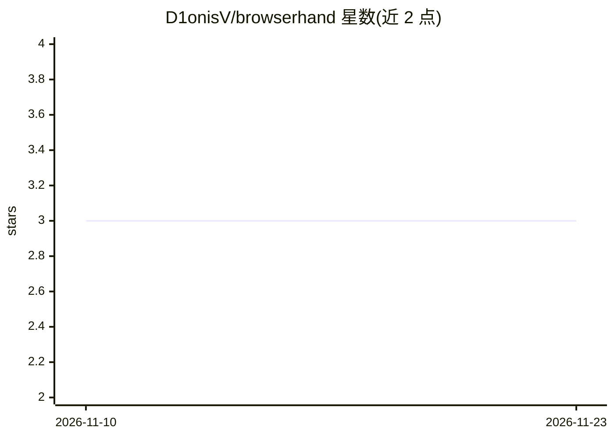

# D1onisV/browserhand

⭐ 3 · JavaScript · MIT · 推送 2026-11-09 · [GitHub](https://github.com/D1onisV/browserhand) · 个人维护

**让 Claude Code 操控你真实浏览器的扩展+本地宿主**

BrowserHand 由一个 Chromium 扩展和一个仅监听 127.0.0.1 的本地 Node 宿主组成，让 Claude Code 读取并操作用户已登录的真实浏览器：工具栏聊天下发自然语言请求，支持逐标签页访问勾选、页面结构化读取（标题/控件映射、清理后 HTML、控制台与网络日志）、点击输入等页面事件、截图，以及视频帧提取、本地语音识别字幕、节拍检测与剪辑。区别于 Playwright/Puppeteer 这类另起空白浏览器的方式，它复用现有会话；依赖 Node.js 18+、已登录的 Claude Code，音视频功能另需可选的 Python 3.9+、ffmpeg、yt-dlp。

## 筛选速览

| 维度 | 判定 | 备注 |
|---|---|---|
| AI 角色 | `ai-ecosystem` | LLM/agent 周边工具 |
| 许可风险 | `permissive` | MIT |
| 部署形态 | `desktop` | 安装包/桌面程序 |
| 模型依赖 | locked-api |  |
| 硬件要求 | — | 无带数字的原话,不猜 |
| 安装摩擦 | `low` | 无编译、无系统依赖或容器化 |
| 成熟度 | — | 结构信号不足 |

## 能力要点

- 扩展+本地宿主架构，宿主仅监听 127.0.0.1 并校验扩展 ID 与随机 token
- 逐标签页访问控制，未勾选的标签页对 Claude 不可见
- 视频/音频处理：帧表、本地语音识别字幕、节拍检测、剪辑与 GIF
- 工具栏聊天之外，任何 Claude Code 会话可通过 bh.js 命令行或 skill 接入

## 适用场景

- 让我已登录的浏览器里多个标签页的内容被比较和整理
- 分析页面视频内容并按时间戳定位关键画面
- 用自然语言让 Claude 代我点击、填表、截图

## 场景标签

`浏览器自动化` · 领域:效率与自动化

## 证据(README 行号)

> L16: BrowserHand is a browser extension plus a small local host that gives Claude Code hands in your real browser. You t
> L18: Unlike automation tools that launch a separate, empty browser, BrowserHand works inside the browser you are already

## 星数曲线

2026-11-10 3 → 2026-11-23 3（+0）

---
*卡片 v1 · prompt 1.4 · 生成 2026-11-22 · 置信度 high · 依据 README sha `28fbeaf58705` · [字段定义](../../DATASET.md)*
