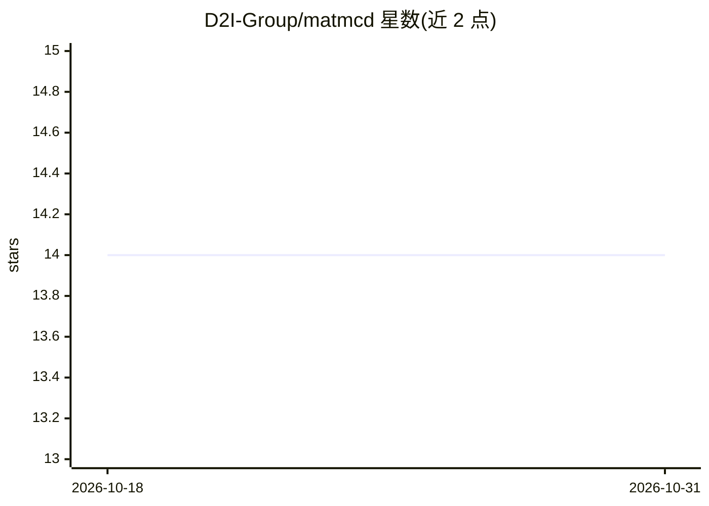

# D2I-Group/matmcd

⭐ 14 · Python · MIT · 推送 2026-10-29 · [GitHub](https://github.com/D2I-Group/matmcd) · [官网](https://d2i-group.github.io/matmcd/) · 组织维护

**LLM 多智能体增强多模态因果发现的研究框架（ACL 2025 Findings）**

ACL 2025 Findings 论文 MATMCD 的官方代码库：通过工具增强的 LLM 多智能体系统（数据增强 DA-Agent 与因果约束 CC-Agent）结合统计因果发现算法（PC、ES、DirectLiNGAM 等），融合时间序列、元数据、网页文档与日志等多模态数据，生成并精化因果图；模块化设计允许替换 LLM 与 SCD 算法。面向科研用户复现论文实验，提供基准数据集（AutoMPG、DWD Climate、Sachs 等）与 AIOps 根因分析实验脚本，运行需在 config.py 配置 API key 并自行下载数据集。

## 筛选速览

| 维度 | 判定 | 备注 |
|---|---|---|
| AI 角色 | `ai-native` | 本体是模型或模型工具 |
| 许可风险 | `permissive` | MIT |
| 部署形态 | `library` | 以包/库形式分发 |
| 模型依赖 | — | README 未给出锁定关系 |
| 硬件要求 | — | 无带数字的原话,不猜 |
| 安装摩擦 | `low` | 无编译、无系统依赖或容器化 |
| 成熟度 | — | 结构信号不足 |

## 能力要点

- DA-Agent 检索/摘要语义上下文，CC-Agent 验证或反驳因果链接
- 支持模块化替换 LLM 与统计因果发现算法（PC、ES、DirectLiNGAM）
- 融合时间序列、元数据、网页文档与日志四类模态
- 提供基准数据集与微服务根因分析（RCA）实验脚本

## 适用场景

- 在多模态数据上做因果发现并复现论文结果
- 对微服务系统做根因定位分析
- 替换不同 LLM 或 SCD 算法对比因果发现效果

## 场景标签

`多智能体` `科研工具` · 领域:Agent 开发

## 证据(README 行号)

> L15: This is the official repository for ACL 2025 (Findings) paper "Exploring Multi-Modal Data with Tool-Augmented LLM A
> L19: Traditional causal discovery methods rely solely on statistical correlations in observational data, overlooking val
> L33:  - **Multi-modal data**: integrates time series data, metadata, web documents, and logs to enrich semantic context 

## 星数曲线

2026-10-18 14 → 2026-10-31 14（+0）

---
*卡片 v1 · prompt 1.4 · 生成 2026-10-31 · 置信度 mid · 依据 README sha `008b023e1b07` · [字段定义](../../DATASET.md)*
