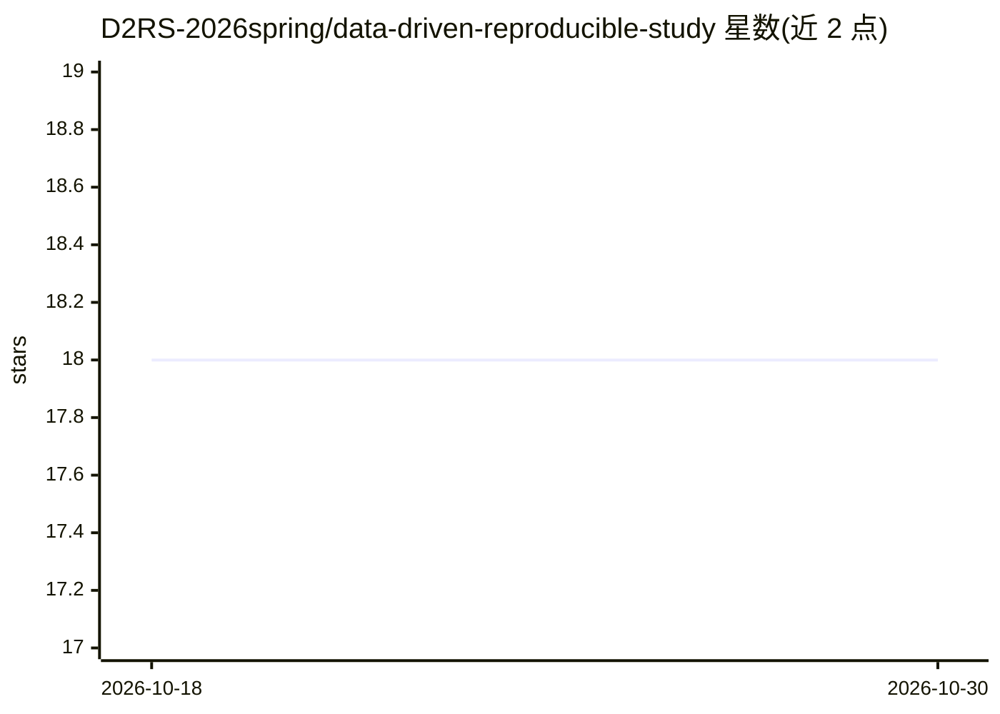

# D2RS-2026spring/data-driven-reproducible-study

⭐ 18 · TeX · NOASSERTION · 推送 2026-03-14 · [GitHub](https://github.com/D2RS-2026spring/data-driven-reproducible-study) · [官网](https://d2rs-2026spring.github.io/data-driven-reproducible-study/) · 组织维护 · 中文 README

**《数据驱动的可重复性研究》研究生课程讲义库**

高校课程的教学资料库，包含讲义、示例代码、实践作业与参考资料，课程目标是教授学生在科学研究中实现数据驱动的可重复性。课程共 10 次课 32 学时，内容按项目组织为 4 个模块：环境搭建（工具链与可重复分析环境）、数据分析（分组统计、转录组学、微生物组）、人工智能（机器学习、手搓神经网络、拉曼光谱识别病原菌、调用大语言模型、计算机视觉）、开发协作（Git 协作、开发 R 包）。考核方式为 3-5 人小组共创项目并通过 Git 追踪贡献。学生需自备电脑并安装 R、Python 等软件。

## 筛选速览

| 维度 | 判定 | 备注 |
|---|---|---|
| AI 角色 | `ai-knowledge` | 知识聚合/清单类 |
| 许可风险 | `none` | NOASSERTION |
| 部署形态 | `None` |  |
| 模型依赖 | — | README 未给出锁定关系 |
| 硬件要求 | — | 无带数字的原话,不猜 |
| 安装摩擦 | `low` | 无编译、无系统依赖或容器化 |
| 成熟度 | — | 结构信号不足 |

## 能力要点

- 4 个模块、10 次课的项目驱动课程组织
- 涵盖机器学习、神经网络、LLM 调用、计算机视觉等 AI 主题讲义
- 以 3-5 人小组项目共创并通过 Git 追踪个人贡献作为考核
- 仓库含讲义、示例代码、实践作业与参考资料

## 适用场景

- 按模块自学可重复性研究方法与工具链
- 研究生开展小组数据分析或研究复现项目参考
- 查找转录组学、微生物组、AI 应用等主题的教学示例代码

## 场景标签

`教程课程` · 领域:学习与行业

## 证据(README 行号)

> L5: 本项目是《数据驱动的可重复性研究》课程的教学资料库。该课程旨在教授学生如何在科学研究中实现数据驱动的可重复性，确保研究结果的可验证性和可靠性。
> L49: 本课程采用项目驱动的教学方式。每次课程围绕一个独立但相互关联的项目展开。课程内容以"项目"为单位进行组织。所有项目可分为 4 个模块，分别是环境搭建模块、数据分析模块、人工智能模块、开发协作模块。每个模块的内容包括：
> L65: 1. 机器学习算法及实现

## 星数曲线

2026-10-18 18 → 2026-10-30 18（+0）

---
*卡片 v1 · prompt 1.4 · 生成 2026-10-29 · 置信度 high · 依据 README sha `bff4b933c098` · [字段定义](../../DATASET.md)*
