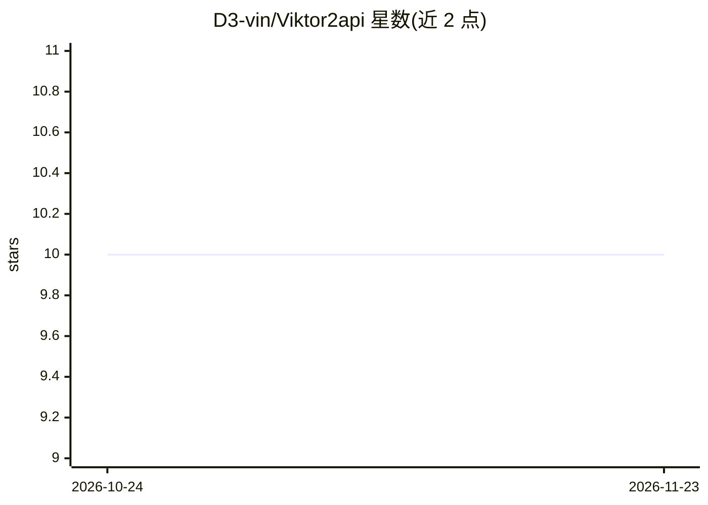

# D3-vin/Viktor2api

⭐ 10 · Go · MIT · 推送 2026-10-22 · [GitHub](https://github.com/D3-vin/Viktor2api) · [官网](https://t.me/D3_vin) · 个人维护

**把 Viktor AI 代理为 OpenAI 兼容接口供 OpenCode 使用的代理**

用 Go 编写的单二进制代理程序：将 Slack 上的 Viktor AI agent 封装为 OpenAI 兼容 provider，供 OpenCode 等工具接入。功能包括响应流式输出、推理过程流（需 JWT）、生成文件自动下载、经 git pull 同步代码改动、本地仪表盘（端口 6061）切换模型与推理等级，以及提取 Slack token/JWT 的 Chrome 扩展。需自行从 Slack/Viktor 会话获取凭证；README 声明仅供教育与互操作用途，与 Slack/Viktor 无关联。

## 筛选速览

| 维度 | 判定 | 备注 |
|---|---|---|
| AI 角色 | `ai-ecosystem` | LLM/agent 周边工具 |
| 许可风险 | `permissive` | MIT |
| 部署形态 | `desktop` | 安装包/桌面程序 |
| 模型依赖 | — | README 未给出锁定关系 |
| 硬件要求 | — | 无带数字的原话,不猜 |
| 安装摩擦 | `low` | 无编译、无系统依赖或容器化 |
| 成熟度 | — | 结构信号不足 |

## 能力要点

- 将 Viktor AI 封装为 OpenAI 兼容接口，流式输出与推理过程流
- 生成文件自动保存到 viktor_media/，支持 git pull 自动同步改动
- 本地仪表盘可切换模型与推理等级（N/L/M/H）
- Chrome 扩展提取 Slack token 与 JWT；单二进制无依赖，跨平台

## 适用场景

- 在 OpenCode 中把 Viktor 当作模型 provider 使用
- 让远程 AI agent 查看本地代码并回写文件改动
- 通过仪表盘调整模型与推理等级而无需打开 app.viktor.com

## 场景标签

`模型网关` · 领域:Agent 开发

## 证据(README 行号)

> L3: OpenAI-compatible proxy to Viktor AI agent for use with OpenCode.
> L19: - 🔄 **Real-time streaming** — Viktor's responses stream directly into OpenCode as they arrive
> L82:     "viktor": {

## 星数曲线

2026-10-24 10 → 2026-11-23 10（+0）

---
*卡片 v1 · prompt 1.4 · 生成 2026-11-20 · 置信度 high · 依据 README sha `63c4bd4c470c` · [字段定义](../../DATASET.md)*
