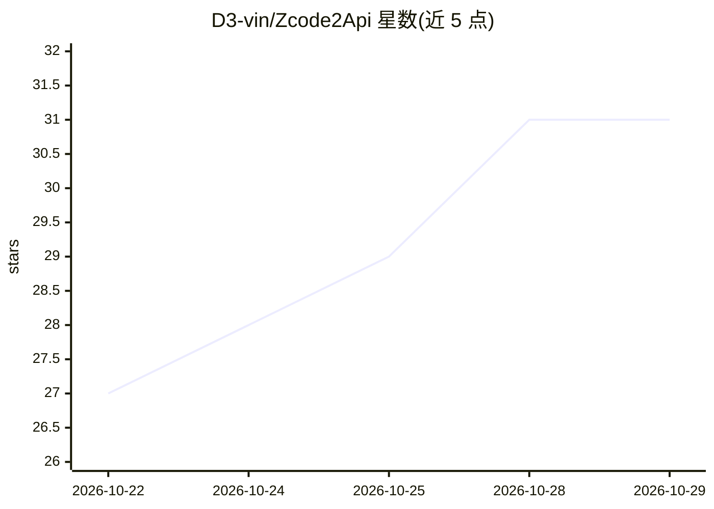

# D3-vin/Zcode2Api

⭐ 31 · Go · NOASSERTION · 推送 2026-10-22 · [GitHub](https://github.com/D3-vin/Zcode2Api) · [官网](https://t.me/D3_vin) · 个人维护

**将 Z.AI ZCode 账号池转换为 OpenAI/Anthropic 兼容 API 的代理网关**

用 Go 编写的单二进制代理服务器：把 Z.AI（ZCode Start Plan）账号的 JWT 池转换为 Anthropic Messages（/v1/messages）与 OpenAI Chat Completions（/v1/chat/completions）双协议端点，供 Cursor、Claude Code、OpenCode 等兼容客户端接入。内置账号池轮换、429/负载错误自动故障转移、代理出口粘滞/轮换、阿里云验证码处理（需 Node.js）、SQLite 存储与实时配额仪表盘。模型目录从账号账单同步（当前 GLM-5.3 / GLM-5.3-Flash），声明仅供教育与互操作用途。

## 筛选速览

| 维度 | 判定 | 备注 |
|---|---|---|
| AI 角色 | `ai-ecosystem` | LLM/agent 周边工具 |
| 许可风险 | `none` | NOASSERTION |
| 部署形态 | `desktop` | 安装包/桌面程序 |
| 模型依赖 | locked-api |  |
| 硬件要求 | — | 无带数字的原话,不猜 |
| 安装摩擦 | `low` | 无编译、无系统依赖或容器化 |
| 成熟度 | — | 结构信号不足 |

## 能力要点

- Anthropic + OpenAI 双协议端点，OpenAI 格式自动转换为 Anthropic
- JWT 账号池轮换与 429/3012/3007/3009/3010/529 错误自动故障转移
- 代理出口粘滞/轮换模式、IP 探测与自动暂停
- 内置验证码处理（嵌入式 Node.js 模块）与配额实时仪表盘

## 适用场景

- 在 Cursor、Claude Code、OpenCode 等客户端中使用 Zcode 账号的模型
- 多账号 JWT 池化管理，配额耗尽自动切换
- 通过代理出口轮换应对限流与负载错误

## 场景标签

`模型网关` · 领域:Agent 开发

## 证据(README 行号)

> L3: OpenAI & Anthropic-compatible proxy for Z.AI (ZCode Start Plan) with JWT account pool, automatic failover, captcha h
> L20: - 🔓 **Dual Protocol** — Anthropic Messages (`/v1/messages`) + OpenAI Chat (`/v1/chat/completions`)

## 星数曲线

2026-10-22 27 → 2026-10-29 31（+4）

---
*卡片 v1 · prompt 1.4 · 生成 2026-10-26 · 置信度 high · 依据 README sha `4059015ae00a` · [字段定义](../../DATASET.md)*
