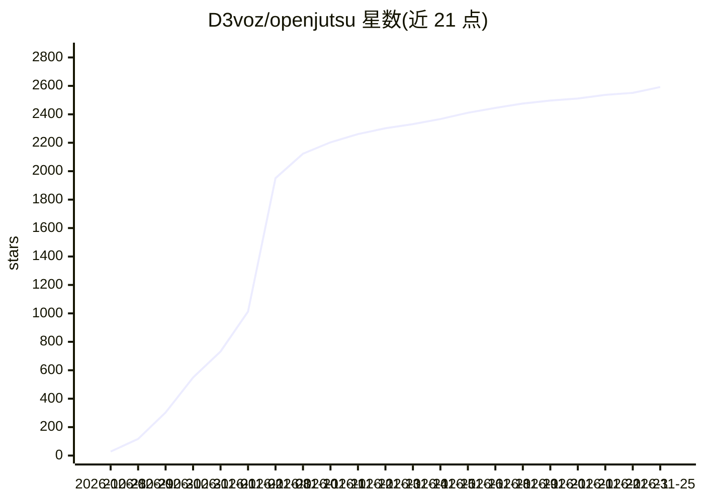

# D3voz/openjutsu

⭐ 2,592 · TypeScript · MIT · 推送 2026-10-30 · [GitHub](https://github.com/D3voz/openjutsu) · 个人维护

**给创作者的本地视频换人工具：上传视频与角色照即可替换主角**

基于 ComfyUI 工作流与 Next.js 前端的开源本地应用，核心模型为 MiniMax H3（视频生成）、SAM 3.1（人物跟踪）与 Qwen3-VL 8B（画面描述与提示词生成）。支持单/多人换装换人、物体增删换背景、由单图生成视频、17 种光影重打光，以及成片后的人脸修复与调色。运行要求 NVIDIA GPU（测试环境 RTX 4060 Ti 16GB + 64GB 内存），需自建 ComfyUI 0.41.2+、安装多个自定义节点包并下载相应模型文件；480p 6 秒片段约需 6–13 分钟。

## 筛选速览

| 维度 | 判定 | 备注 |
|---|---|---|
| AI 角色 | `ai-native` | 本体是模型或模型工具 |
| 许可风险 | `permissive` | MIT |
| 部署形态 | `library` | 以包/库形式分发 |
| 模型依赖 | — | README 未给出锁定关系 |
| 硬件要求 | — | 无带数字的原话,不猜 |
| 安装摩擦 | `low` | 无编译、无系统依赖或容器化 |
| 成熟度 | — | 结构信号不足 |

## 能力要点

- Simple/Advanced motion transfer：1–4 个角色逐镜头按角色匹配替换
- Object swap：对 SAM 跟踪区域做更换、移除或背景替换，仅重生成该区域
- From picture：FLUX 预备角色姿态图后经 SolarRenderer 生成至多 15 秒视频，可选 17 种 Relight 光影
- Post-processing：小脸放大重绘回贴与 DCTL 调色后处理工作流

## 适用场景

- 把视频里的主角换成自己上传的角色照片
- 为视频中的人物更换发型、服装或移除/替换物体
- 从一张角色图生成带新光影的视频片段
- 对已生成的视频做人脸修复与调色

## 场景标签

`图像生成` `视频生成` · 领域:内容生成

## 证据(README 行号)

> L3: An open-source, Genjutsu-style character and object swap for video. Drop a video and a character photo, press **Gene
> L5: The app is a small Next.js front end over a ComfyUI workflow. It uses `@comfyorg/sdk`, following Comfy's comfy-resho
> L27: - **Simple motion transfer**: available. One character replaces the main person (the one who fills the most of the 

## 星数曲线

2026-10-28 28 → 2026-11-25 2,592（+2,564）

---
*卡片 v1 · prompt 1.4 · 生成 2026-11-23 · 置信度 high · 依据 README sha `e3f7379d24a9` · [字段定义](../../DATASET.md)*
