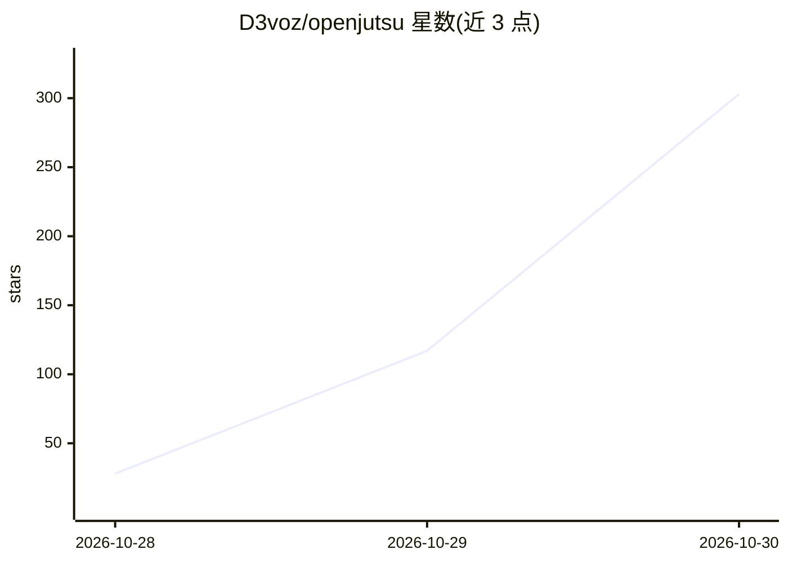

# D3voz/openjutsu

⭐ 303 · TypeScript · MIT · 推送 2026-10-29 · [GitHub](https://github.com/D3voz/openjutsu) · 个人维护

**本地视频角色/物体替换工具：一键换人并保留运镜与配乐**

基于 ComfyUI 工作流与 Next.js 前端的本地视频换人应用：上传视频与角色照片后，用 MiniMax H3 生成视频、SAM 3.1 跟踪人物、Qwen3-VL 8B 描述画面与写提示词，将视频中主角替换为指定角色，也可换发型衣物、移除物体或合成新场景，镜头、剪辑、运动与音轨保留。提供简单/高级（1-4 角色）运动传递、物体替换、从图片生成与面部/调色后处理等模式。需 NVIDIA GPU（RTX 4060 Ti 16GB 测试）、ComfyUI 0.41.2+ 及十余个自定义节点，模型文件需手动下载放置。

## 筛选速览

| 维度 | 判定 | 备注 |
|---|---|---|
| AI 角色 | `ai-native` | 本体是模型或模型工具 |
| 许可风险 | `permissive` | MIT |
| 部署形态 | `library` | 以包/库形式分发 |
| 模型依赖 | — | README 未给出锁定关系 |
| 硬件要求 | — | 无带数字的原话,不猜 |
| 安装摩擦 | `low` | 无编译、无系统依赖或容器化 |
| 成熟度 | — | 结构信号不足 |

## 能力要点

- MiniMax H3 生成 + SAM 3.1 跟踪 + Qwen3-VL 8B 描述的本地管线
- 支持 1-4 角色高级替换、物体替换、从图片生成新造型与场景
- 面部修复与调色后处理工作流
- 上传任务前自动检查 ComfyUI 节点与模型文件完整性

## 适用场景

- 把视频里的主角换成我自己照片里的角色
- 批量更换视频人物发型、衣物或移除物体
- 用一张图片为新角色生成新造型与场景并合成视频

## 场景标签

`视频生成` · 领域:内容生成

## 证据(README 行号)

> L3: An open-source, Genjutsu-style character and object swap for video. Drop a video and a character photo, press **Gene
> L5: The app is a small Next.js front end over a ComfyUI workflow. It uses `@comfyorg/sdk`, following Comfy's comfy-resho
> L31: - An NVIDIA GPU. Tested on an RTX 4060 Ti 16 GB with 64 GB of system RAM; the H3 int8 models stream from RAM.

## 星数曲线

2026-10-28 28 → 2026-10-30 303（+275）

---
*卡片 v1 · prompt 1.4 · 生成 2026-10-28 · 置信度 mid · 依据 README sha `736a69e8e9d6` · [字段定义](../../DATASET.md)*
