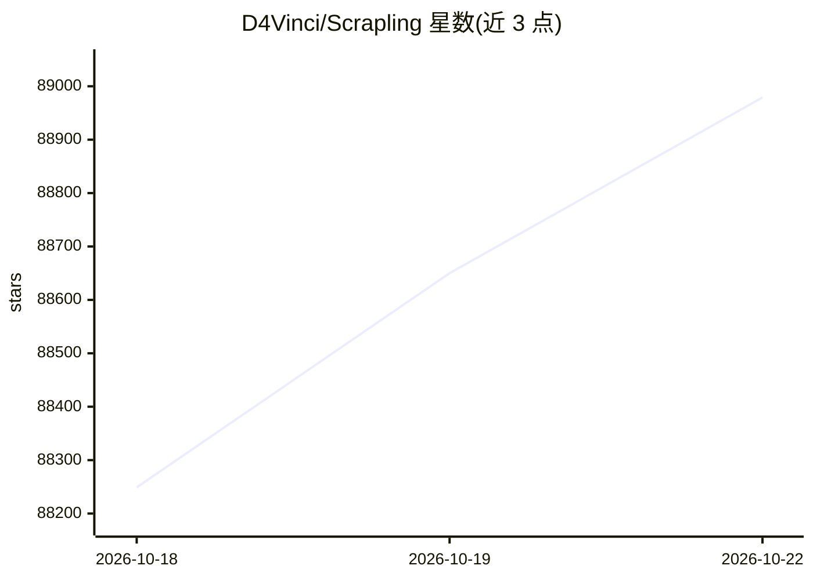

# D4Vinci/Scrapling

⭐ 88,979 · Python · BSD-3-Clause · 推送 2026-10-21 · [GitHub](https://github.com/D4Vinci/Scrapling) · [官网](https://scrapling.readthedocs.io/en/latest/) · 个人维护 · 中文 README

**Python 网页抓取框架：从单次请求到全站爬取一体化**

面向开发者的 Python 网页抓取库，整合快速 HTTP 请求、Playwright 隐身浏览器、解析与并发爬虫：支持 CSS/XPath/正则选择器、元素智能重定位、Cloudflare Turnstile 处理、代理轮换、会话管理、暂停恢复、AutoThrottle 与 JSON/JSONL/CSV/XML 导出，并提供 Scrapy 风格的 Spider 模板。可通过 Python、CLI、交互式 shell 或 MCP server/Agent Skill 供 AI agent 调用浏览与抽取数据，可输出 Markdown。以 pip 包与 Docker 镜像分发。

## 筛选速览

| 维度 | 判定 | 备注 |
|---|---|---|
| AI 角色 | `ai-enhanced` | 去掉 AI 部分产品仍成立 |
| 许可风险 | `permissive` | BSD-3-Clause |
| 部署形态 | `self-host` | docker 或自建部署 |
| 模型依赖 | — | README 未给出锁定关系 |
| 硬件要求 | — | 无带数字的原话,不猜 |
| 安装摩擦 | `low` | 无编译、无系统依赖或容器化 |
| 成熟度 | — | 结构信号不足 |

## 动量与使用信号

- 维护:`active` — 距上次 push 0.7 天,年发版 24,41 位贡献者
- 涨星:近 1 天 **+276**(自 20261016 起算)
- 安装:pypi 包 `scrapling` 月下载 919,855
- 平台:— · 协议:MCP

## 能力要点

- Scrapy 风格 Spider API：并发、暂停恢复、AutoThrottle、流式输出
- StealthyFetcher 隐身浏览器、TLS 指纹伪装与 Cloudflare Turnstile 处理
- MCP server 与 Agent Skill，供 AI agent 浏览和抽取数据
- 代理轮换、域名/广告屏蔽、后台 API 捕获、多格式导出

## 适用场景

- 抓取动态网页并把整站内容收集为干净的 Markdown
- 构建并发爬虫并导出为 JSON/CSV 等格式
- 让 AI agent 通过 MCP 调用抓取与数据抽取能力
- 绕过反爬机制采集数据（含代理轮换与会话管理）

## 场景标签

`网页抓取` · 领域:效率与自动化

## 证据(README 行号)

> L56: Scrapling is a Python Web Scraping framework that brings fast HTTP requests, stealth browsers, powerful parsing, an
> L60: Use it from Python, the terminal, or your AI agent through its MCP server and Agent Skill. From extracting a few fi

## 星数曲线

2026-10-18 88,249 → 2026-10-22 88,979（+730）

---
*卡片 v1 · prompt 1.4 · 生成 2026-10-20 · 置信度 high · 依据 README sha `0f408fa65b11` · [字段定义](../../DATASET.md)*
