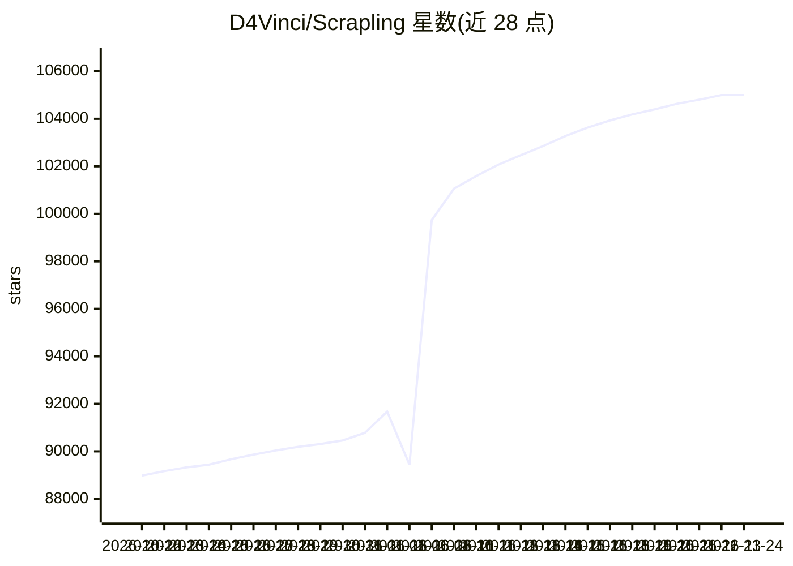

# D4Vinci/Scrapling

⭐ 105,292 · Python · BSD-3-Clause · 推送 2026-11-23 · [GitHub](https://github.com/D4Vinci/Scrapling) · [官网](https://scrapling.readthedocs.io/en/latest/) · 个人维护 · 中文 README

**供开发者使用的 Python 网页抓取框架，支持 AI agent 通过 MCP 调用**

Scrapling 是一个将 HTTP 请求、隐身浏览器、页面解析与并发爬取整合到单一 Python 库中的网页抓取框架。核心能力包括：Fetcher 静态抓取与 StealthyFetcher 动态渲染、持久会话与代理轮换、被拦截请求的自动检测重试、AutoThrottle 自适应限速、暂停/恢复爬取、Scrapy 风格的 Spider API 与多种爬虫模板，以及 JSON/JSONL/CSV/XML 导出。除 Python 与 CLI 外，还提供 MCP server 和 Agent Skill，供 AI agent 浏览网页并提取数据。

## 筛选速览

| 维度 | 判定 | 备注 |
|---|---|---|
| AI 角色 | `ai-enhanced` | 去掉 AI 部分产品仍成立 |
| 许可风险 | `permissive` | BSD-3-Clause |
| 部署形态 | `self-host` | docker 或自建部署 |
| 模型依赖 | — | README 未给出锁定关系 |
| 硬件要求 | — | 无带数字的原话,不猜 |
| 安装摩擦 | `low` | 无编译、无系统依赖或容器化 |
| 成熟度 | — | 结构信号不足 |

## 动量与使用信号

- 维护:`active` — 距上次 push 0.7 天,年发版 24,41 位贡献者
- 涨星:近 1 天 **+276**(自 20261016 起算)
- 安装:pypi 包 `scrapling` 月下载 919,855
- 平台:— · 协议:MCP

## 能力要点

- MCP server 与 Agent Skill 使 AI agent 可直接调用抓取能力
- Scrapy 风格 Spider API：并发爬取、AutoThrottle、暂停/恢复、流式输出
- StealthyFetcher 支持 Playwright Chromium，可处理 Cloudflare Turnstile/Interstitial
- 自适应元素追踪与干净 Markdown 输出，内置 JSON/JSONL/CSV/XML 导出

## 适用场景

- 从静态页面或 JavaScript 渲染页面抓取数据
- 用 Spider 模板整站采集并导出为结构化文件
- 让 AI agent 通过 MCP 浏览网页并提取数据

## 场景标签

`网页抓取` · 领域:效率与自动化

## 证据(README 行号)

> L56: Scrapling is a Python Web Scraping framework that brings fast HTTP requests, stealth browsers, powerful parsing, an
> L60: Use it from Python, the terminal, or your AI agent through its MCP server and Agent Skill. From extracting a few fi
> L67: - **Scrape with AI or from your terminal**: An MCP server for AI agents to browse and extract data, an Agent Skill,

## 星数曲线

2026-10-22 88,979 → 2026-11-24 104,997（+16,018）

---
*卡片 v1 · prompt 1.4 · 生成 2026-11-24 · 置信度 high · 依据 README sha `375684bc5f35` · [字段定义](../../DATASET.md)*
