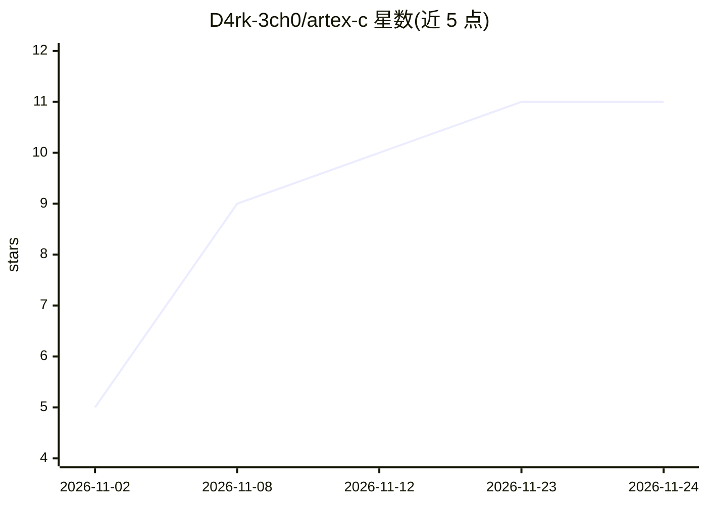

# D4rk-3ch0/artex-c

⭐ 11 · Go · AGPL-3.0 · 推送 2026-10-15 · [GitHub](https://github.com/D4rk-3ch0/artex-c) · 个人维护 · 中文 README

**授权环境下的 LLM 多 agent 自主渗透测试系统**

基于上游 ARTEX v0.3.15 二次开发的自主渗透测试平台：Go 单体后端内嵌 Next.js 前端，依赖 PostgreSQL，LLM 提供探索能力。核心为探索图+资产图双图架构，planner 通过跨唤醒共享 todolist 派发意图、worker 领取意图执行工具并写回两图；支持蜜罐签名识别、出口敏感信息审查、tarpit 熔断、范围强制（RoE）、人工审批门、流量录制代理、漏洞复测与 ScopeSentry 资产同步。提供一键脚本、Docker Compose、预编译二进制、源码编译等安装方式。许可为 AGPL-3.0，README 明确仅限授权或本地隔离环境使用。

## 筛选速览

| 维度 | 判定 | 备注 |
|---|---|---|
| AI 角色 | `ai-native` | 本体是模型或模型工具 |
| 许可风险 | `viral` | AGPL-3.0 |
| 部署形态 | `self-host` | docker 或自建部署 |
| 模型依赖 | — | README 未给出锁定关系 |
| 硬件要求 | — | 无带数字的原话,不猜 |
| 安装摩擦 | `low` | 无编译、无系统依赖或容器化 |
| 成熟度 | — | 结构信号不足 |

## 能力要点

- 探索图+资产图双图架构，支撑资产覆盖度统计与覆盖图可视化
- planner 跨唤醒共享 todolist，按依赖逐步派意图以稳定多步利用链
- 人工审批门、拦截审批详情与人在环路对话
- 蜜罐静态签名识别、出口敏感信息审查与反测绘门控

## 适用场景

- 在自有授权资产上执行自动化渗透探索并记录攻击链路
- 修复发布后对漏洞发起独立复测会话确认是否已修复
- 接入 ScopeSentry 资产数据后按公司范围归并进行探索
- 通过审批卡对 agent 的高危操作进行人工拦截

## 场景标签

`网络安全` `多智能体` · 领域:Agent 开发

## 证据(README 行号)

> L3: AI 自主渗透测试系统（Go 后端 + Next.js 前端）
> L253: ARTEX 是一套 **LLM 多 agent 驱动的自主渗透系统**：Go 单体后端（内嵌 Next.js 前端）+ PostgreSQL，agent 能力由 `norma` SDK 提供（`agentcore` / `too
> L278: - **探索图（Exploration Graph，每任务独立）**：一次任务的“思考与推进”过程。节点为 `goal（目标）/ intent（意图）/ fact（事实）/ finding（漏洞）/ hint（提示）`，靠 `s

## 星数曲线

2026-11-02 5 → 2026-11-24 11（+6）

---
*卡片 v1 · prompt 1.4 · 生成 2026-11-20 · 置信度 mid · 依据 README sha `bf3fafaa46e2` · [字段定义](../../DATASET.md)*
