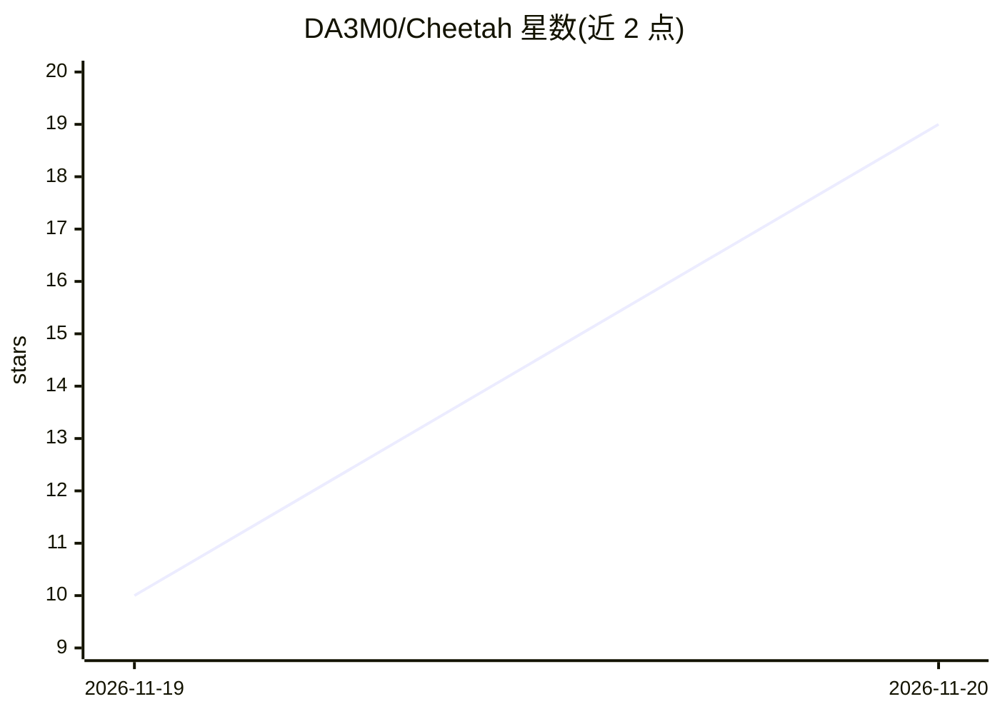

# DA3M0/Cheetah

⭐ 19 · Rust · Apache-2.0 · 推送 2026-11-18 · [GitHub](https://github.com/DA3M0/Cheetah) · 个人维护

**本地 LLM 推理服务器：运行 Safetensors 模型并提供 OpenAI 兼容 API**

用 Rust 与 C 编写的本地语言模型 CLI 与 OpenAI 兼容 API 网关，运行 Safetensors decoder 模型。核心机制：Ant 分级内存按张量粒度管理 VRAM/RAM/Disk 驻留；CPU 原生后端使用 mmap BF16 权重与 AVX2 SIMD 内核；Vulkan 为可选 GPU 后端，需 --features vulkan 编译并依赖 glslc。提供 /v1/chat/completions 接口（SSE 流式、tool calls、API keys）与交互式 CLI 聊天。不支持 GGUF，需用 cheetah init 将 Hugging Face 模型转换为 prepared 目录。README 仅记录 Linux 构建，Windows 需 WSL2，原生 Windows 构建未验证。

## 筛选速览

| 维度 | 判定 | 备注 |
|---|---|---|
| AI 角色 | `ai-ecosystem` | LLM/agent 周边工具 |
| 许可风险 | `permissive` | Apache-2.0 |
| 部署形态 | `None` |  |
| 模型依赖 | — | README 未给出锁定关系 |
| 硬件要求 | — | 无带数字的原话,不猜 |
| 安装摩擦 | `medium` | 含编译或系统依赖之一 |
| 成熟度 | — | 结构信号不足 |

## 能力要点

- OpenAI 兼容 /v1/chat/completions 接口，支持 SSE 流式、tool calls、API keys
- Ant 分级内存：按张量控制 VRAM/RAM/Disk 页级驻留
- CPU 原生后端使用 mmap BF16 权重与 AVX2 SIMD 内核
- 支持 F32/F16/BF16/Q8 权重精度与 Qwen2/Qwen3/Llama/Gemma/Mistral/Phi/Mixtral 架构

## 适用场景

- 在本地跑一个小模型做离线聊天
- 在本地起一个 OpenAI 兼容接口供脚本或客户端调用
- 用分级内存在小显存 GPU 上加载较大模型

## 场景标签

`推理引擎` · 领域:训练与推理

## 证据(README 行号)

> L3: **Cheetah** is a local language-model CLI and OpenAI-compatible API gateway, written in Rust and C. It runs Safetens
> L10: |🔌 **OpenAI-compatible API**|`/v1/chat/completions` with SSE streaming, tool calls, API keys|
> L66: Cheetah runs Safetensors decoder models. The native CPU backend (the default) requires a **prepared model directory

## 星数曲线

2026-11-19 10 → 2026-11-20 19（+9）

---
*卡片 v1 · prompt 1.4 · 生成 2026-11-20 · 置信度 high · 依据 README sha `62dc2ece918c` · [字段定义](../../DATASET.md)*
