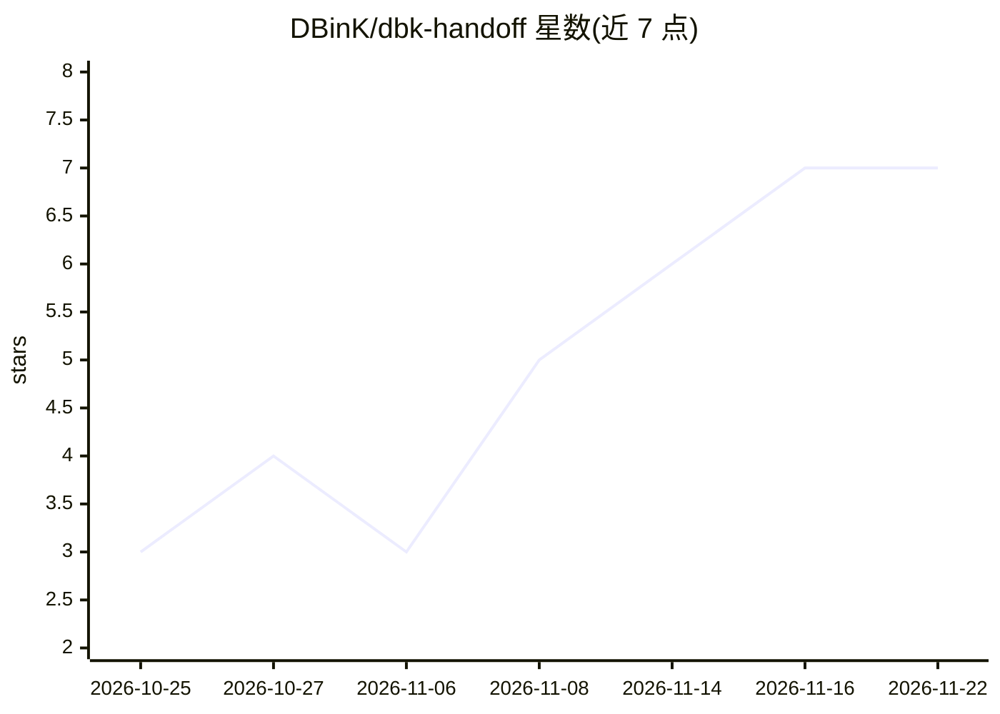

# DBinK/dbk-handoff

⭐ 7 · MIT · 推送 2026-11-13 · [GitHub](https://github.com/DBinK/dbk-handoff) · [官网](https://www.skills.sh/dbink/dbk-handoff/) · 个人维护 · 中文 README

**跨 AI Agent 会话接力的 Skill：快照传递任务断点**

提供 /dbk-handoff 与 /dbk-pickup 两个配套 Skill：前者提炼任务进度、需求对照矩阵、核心文件与已排除方案，生成 .agent/handoff/ 本地 Markdown 快照与引导 Prompt；后者在新会话中校验 Git 工作区状态、汇报断点并默认暂停等待人工确认。支持敏捷自由与 Spec-Driven 双轨模式、跨仓库/跨 worktree 派生交接、快照渐进式加载，并通过自动写入忽略规则避免污染业务仓库。

## 筛选速览

| 维度 | 判定 | 备注 |
|---|---|---|
| AI 角色 | `ai-ecosystem` | LLM/agent 周边工具 |
| 许可风险 | `permissive` | MIT |
| 部署形态 | `library` | 以包/库形式分发 |
| 模型依赖 | — | README 未给出锁定关系 |
| 硬件要求 | — | 无带数字的原话,不猜 |
| 安装摩擦 | `low` | 无编译、无系统依赖或容器化 |
| 成熟度 | — | 结构信号不足 |

## 能力要点

- 本地 Markdown 快照（.agent/handoff/）传递任务状态，含需求对照矩阵与完成度标记
- 接手端强制暂停等待人工确认，未对齐前不修改代码
- 支持跨仓库/跨工作树派生交接
- 前置记录已排除方案（Dead Ends），限定 5~15 个核心工作集

## 适用场景

- 在 Claude Code、Codex、omp 等工具间切换时保留开发上下文
- 新会话接手他人或前一会话的任务前先对齐进度
- 有 PRD 的规范化开发中按需求矩阵交接宏观完成度

## 场景标签

`Agent 记忆` · 领域:Agent 开发

## 证据(README 行号)

> L9: > **用于跨 AI Agent 会话接力的 Agent Skills**
> L13: 本项目提供两个配套 Skill，通过本地 Markdown 快照（`.agent/handoff/xxx.md`）传递任务状态：
> L48: `dbk-handoff` 并非替代现有的 Agent 工具，而是与现有生态分工协作、互为补充：

## 星数曲线

2026-10-25 3 → 2026-11-22 7（+4）

---
*卡片 v1 · prompt 1.4 · 生成 2026-11-20 · 置信度 high · 依据 README sha `98ca3369ad3d` · [字段定义](../../DATASET.md)*
