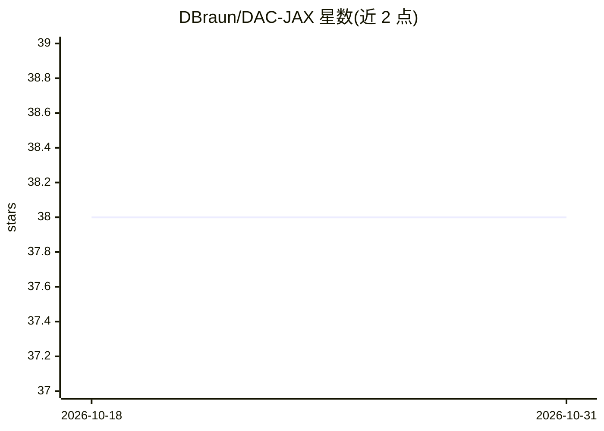

# DBraun/DAC-JAX

⭐ 38 · Python · MIT · 推送 2026-08-23 · [GitHub](https://github.com/DBraun/DAC-JAX) · 个人维护

**DAC 与 EnCodec 神经音频编解码器的 JAX 实现**

非官方的 JAX 实现，复现 Descript DAC 与 Meta EnCodec 两类基于残差向量量化的神经音频编解码器。提供命令行与 Python API 完成音频压缩为 .dac 码本文件及从码本重建 wav，首次运行时自动下载 MIT 许可的预训练权重（16/24/44.1kHz，另含 MusicGen 所用 32kHz EnCodec）。用 uv 管理环境，附训练脚本与 PyTorch 一致性测试；不提供 EnCodec 训练脚本与 Docker 镜像，chunked 压缩方法存在已知问题。

## 筛选速览

| 维度 | 判定 | 备注 |
|---|---|---|
| AI 角色 | `ai-native` | 本体是模型或模型工具 |
| 许可风险 | `permissive` | MIT |
| 部署形态 | `library` | 以包/库形式分发 |
| 模型依赖 | — | README 未给出锁定关系 |
| 硬件要求 | — | 无带数字的原话,不猜 |
| 安装摩擦 | `medium` | 含编译或系统依赖之一 |
| 成熟度 | — | 结构信号不足 |

## 能力要点

- CLI 与 jax.jit 程序化接口完成 encode/decode
- 预训练权重自动下载，支持 16/24/44.1kHz DAC 与 32kHz EnCodec
- 提供恒定 GPU 显存的分块压缩用法
- 附带训练脚本与对 PyTorch 参考实现的一致性测试

## 适用场景

- 在 JAX 生态中做神经音频压缩与重建
- 复用 Descript/Meta 预训练权重做音频 codec 实验或训练
- 在 JAX/Flax 流水线中集成音频 tokenizer

## 场景标签

`模型训练` · 领域:训练与推理

## 证据(README 行号)

> L3: This repository holds **unofficial** JAX implementations of Descript's DAC and Meta's EnCodec.
> L16: Both EnCodec and DAC are neural audio codecs which use residual vector quantization inside a fully convolutional
> L17: encoder-decoder architecture.

## 星数曲线

2026-10-18 38 → 2026-10-31 38（+0）

---
*卡片 v1 · prompt 1.4 · 生成 2026-10-25 · 置信度 mid · 依据 README sha `08ae21e06b79` · [字段定义](../../DATASET.md)*
