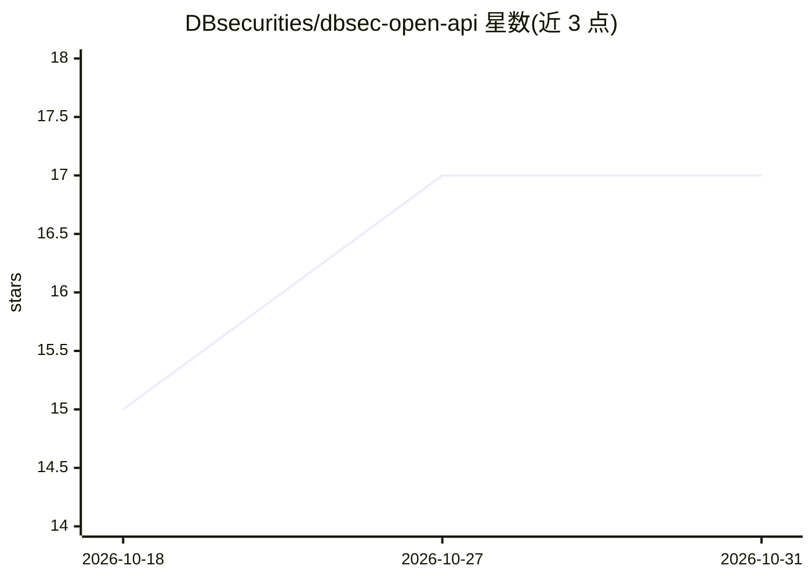

# DBsecurities/dbsec-open-api

⭐ 17 · Python · 推送 2026-08-20 · [GitHub](https://github.com/DBsecurities/dbsec-open-api) · [官网](https://openapi.dbsec.co.kr/) · 组织维护

**DB证券官方 Open API 的 Python SDK、示例与 MCP 服务集合**

DB证券官方提供的 Open API Python 库与示例集合：异步客户端 DBSecClient 覆盖国内/海外股票、国内外期货期权、场内债券全部端点，内置认证令牌自动发放、两级限流、连续查询合并与 WebSocket 重连；另有按 API 一文件的独立示例、浏览器一键执行的 web_test 网页测试器、以及供 Claude Code/Cursor 等 LLM 编码工具查询 API 规格的 MCP 服务器。面向 Python 开发者与个人投资者，需先开设 DB 证券账户并申请 API 密钥；海外期货期权不支持模拟投资。

## 筛选速览

| 维度 | 判定 | 备注 |
|---|---|---|
| AI 角色 | `ai-ecosystem` | LLM/agent 周边工具 |
| 许可风险 | `permissive` | — |
| 部署形态 | `library` | 以包/库形式分发 |
| 模型依赖 | — | README 未给出锁定关系 |
| 硬件要求 | — | 无带数字的原话,不猜 |
| 安装摩擦 | `low` | 无编译、无系统依赖或容器化 |
| 成熟度 | — | 结构信号不足 |

## 能力要点

- 异步 SDK 覆盖 DB 证券 Open API 全部端点，含国内/海外股票、期货期权、债券与实时 WebSocket
- 令牌自动发放/续期（auto_token）与两级 TPS 自动限流
- MCP 服务器供 LLM 编码工具查询 API 分组、参数规格与示例代码
- web_test 本地网页工具一键执行全部 API，含 In/Out 规格与 cURL 预览

## 适用场景

- 用 Python 编写韩国证券的行情查询、下单与自动交易程序
- 在模拟投资环境先测试下单逻辑再投入实盘
- 让 Claude Code/Cursor 等 AI 编码工具通过 MCP 查阅 API 规格生成代码

## 场景标签

`金融量化` · 领域:学习与行业

## 证据(README 行号)

> L7:  DB증권 Open API 전체 그룹 · 엔드포인트 를 한 클라이언트로 호출하는 파이썬 라이브러리 + 예제 모음.
> L22: - **`mcp_server/`** - LLM 코딩 도구(Claude Code·Cursor 등)가 API 그룹·명세·샘플코드를 조회하는 코드 어시스턴트 MCP 서버
> L140: `mcp_server/` 는 LLM 코딩 도구(Claude Desktop · Claude Code · Cursor 등)가 DB증권 Open API 의

## 星数曲线

2026-10-18 15 → 2026-10-31 17（+2）

---
*卡片 v1 · prompt 1.4 · 生成 2026-10-30 · 置信度 high · 依据 README sha `360031caf07f` · [字段定义](../../DATASET.md)*
