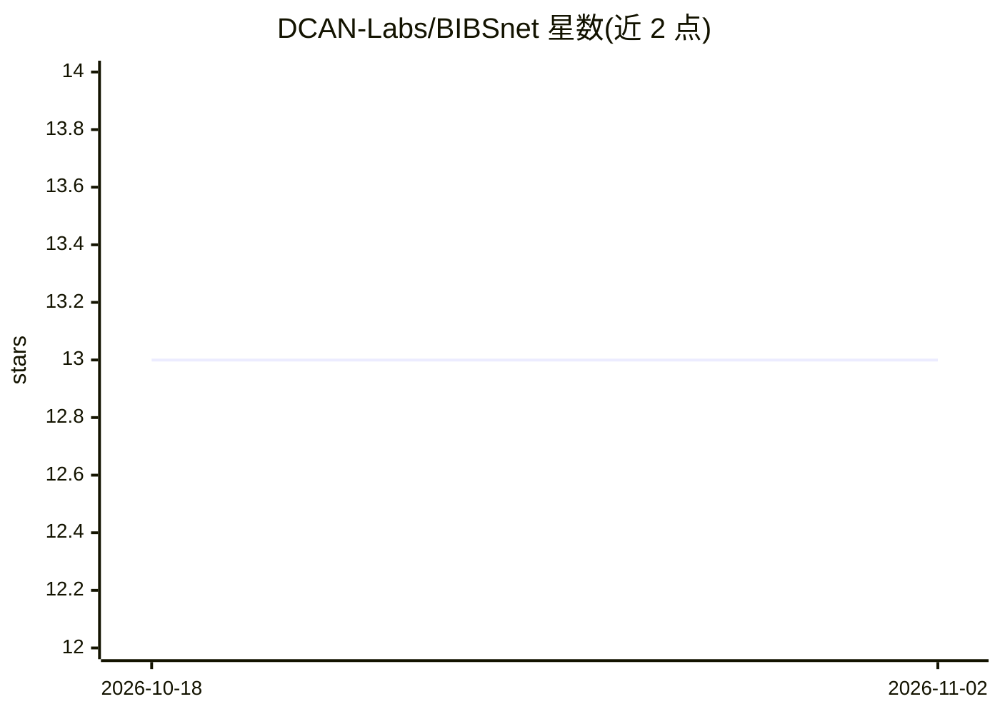

# DCAN-Labs/BIBSnet

⭐ 13 · Python · Apache-2.0 · 推送 2026-08-30 · [GitHub](https://github.com/DCAN-Labs/BIBSnet) · [官网](https://bibsnet.readthedocs.io/en/latest/) · 组织维护

**婴儿脑部 MRI 解剖分割的 BIDS App 深度学习容器**

BIBSNet（Baby and Infant Brain Segmentation Neural Network）是以 BIDS App 容器形式提供的开源深度学习分割模型：基于 nnU-Net，使用大规模人工标注婴儿数据训练并配合数据增强，对婴儿解剖 MRI 生成原生空间的脑分割、脑掩膜及 sidecar JSON（BIDS derivatives）。可嵌入其他处理管线，并可在 Nibabies 中替代 JLF。项目状态为稳定但仅限有限维护，更新以重训模型与关键修复为主。容器从 DockerHub 获取，文档见项目网页。

## 筛选速览

| 维度 | 判定 | 备注 |
|---|---|---|
| AI 角色 | `ai-native` | 本体是模型或模型工具 |
| 许可风险 | `permissive` | Apache-2.0 |
| 部署形态 | `None` |  |
| 模型依赖 | — | README 未给出锁定关系 |
| 硬件要求 | — | 无带数字的原话,不猜 |
| 安装摩擦 | `low` | 无编译、无系统依赖或容器化 |
| 成熟度 | — | 结构信号不足 |

## 能力要点

- 基于 nnU-Net 的婴儿脑 MRI 分割模型，输出 BIDS derivatives
- 以 BIDS App 容器形式提供，可集成到处理管线
- 可在 Nibabies 中替代 JLF
- 官方声明：稳定但非活跃开发，仅模型更新与关键修复

## 适用场景

- 婴儿脑部 MRI 的解剖分割与脑掩膜提取
- 接入 Nibabies 等神经影像流水线替代 JLF
- 作为 BIDS App 在标准化管线中调用

## 场景标签

`目标检测` · 领域:感知与多模态

## 证据(README 行号)

> L11: We introduce BIBSNet (Baby and Infant Brain Segmentation Neural Network), an open-source, community-driven deep lea

## 星数曲线

2026-10-18 13 → 2026-11-02 13（+0）

---
*卡片 v1 · prompt 1.4 · 生成 2026-10-31 · 置信度 high · 依据 README sha `cf2c6b0c8c81` · [字段定义](../../DATASET.md)*
