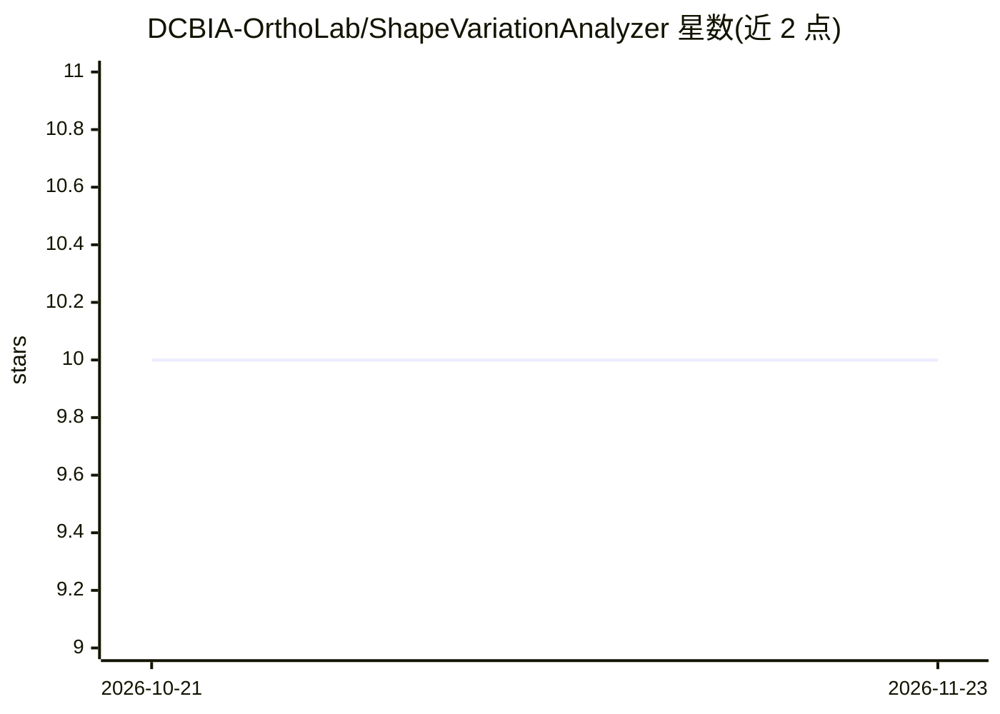

# DCBIA-OrthoLab/ShapeVariationAnalyzer

⭐ 10 · Python · Apache-2.0 · 推送 2026-08-04 · [GitHub](https://github.com/DCBIA-OrthoLab/ShapeVariationAnalyzer) · 组织维护

**3D Slicer 扩展：按形态特征分类 3D 模型**

Shape Variation Analyzer 是一个 3D Slicer 扩展模块，基于深度学习神经网络，按形态变异对 3D 模型进行分类。模块由多个面板组成，覆盖完整流程：创建分类组、计算平均形状、训练分类器以及对形状进行分类。技术上依赖 TensorFlow 作为机器学习后端。许可信息需查看 License.txt。README 未提供安装命令与硬件要求说明。

## 筛选速览

| 维度 | 判定 | 备注 |
|---|---|---|
| AI 角色 | `ai-native` | 本体是模型或模型工具 |
| 许可风险 | `permissive` | Apache-2.0 |
| 部署形态 | `None` |  |
| 模型依赖 | — | README 未给出锁定关系 |
| 硬件要求 | — | 无带数字的原话,不猜 |
| 安装摩擦 | `low` | 无编译、无系统依赖或容器化 |
| 成熟度 | — | 结构信号不足 |

## 能力要点

- 基于深度学习神经网络的 3D 模型形态分类
- 分面板流程：创建分类组、计算平均形状、训练分类器、分类形状
- 以 3D Slicer 扩展形式提供，使用 TensorFlow 后端

## 适用场景

- 对 3D 模型按形态特征进行分组分类
- 训练自定义形状分类器并对新形状做分类
- 计算一组形状的平均形状

## 场景标签

`目标检测` · 领域:感知与多模态

## 证据(README 行号)

> L4: Shape Variation Analyzer allows the classification of 3D models, according to their morphological variation. This to
> L5: The module is composed of multiple panels to perform the different steps of the process: create the classification g

## 星数曲线

2026-10-21 10 → 2026-11-23 10（+0）

---
*卡片 v1 · prompt 1.4 · 生成 2026-11-20 · 置信度 mid · 依据 README sha `5e5d572713c4` · [字段定义](../../DATASET.md)*
