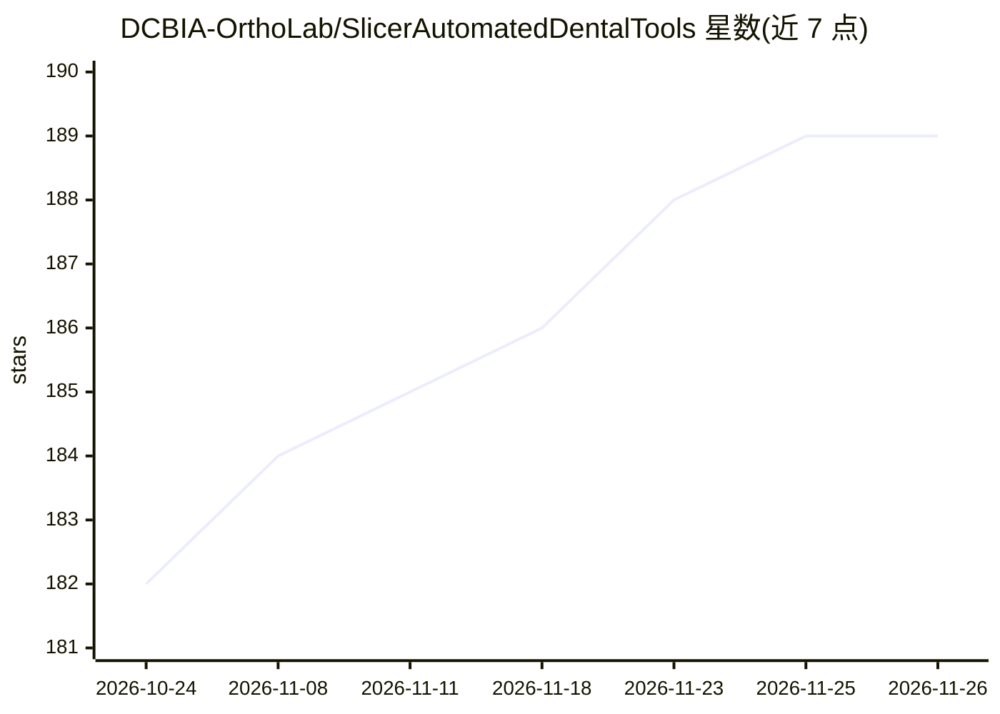

# DCBIA-OrthoLab/SlicerAutomatedDentalTools

⭐ 189 · Python · NOASSERTION · 推送 2026-11-25 · [GitHub](https://github.com/DCBIA-OrthoLab/SlicerAutomatedDentalTools) · 组织维护

**面向正畸/颅面研究的 3D Slicer 自动化牙科分析扩展**

基于 3D Slicer 的扩展，通过图形界面在 CBCT 与口内扫描（IOS）上执行自动分割、标志点识别与自动摆位，无需编程。包含 AMASSS、ALI、ASO、AReg 等 20 余个模块，另有批量裁剪、矩阵变换、匿名化、MRI2CBCT 配准、面部不对称分类等模块；并提供 Python 命令行版本供内部调用。模型需通过模块内按钮手动下载，推荐 12GB 内存。还含一个使用本地 LLM、以自然语言调用其他模块的 Agent。

## 筛选速览

| 维度 | 判定 | 备注 |
|---|---|---|
| AI 角色 | `ai-native` | 本体是模型或模型工具 |
| 许可风险 | `none` | NOASSERTION |
| 部署形态 | `None` |  |
| 模型依赖 | local-ok | 支持本地模型 |
| 硬件要求 | — | 无带数字的原话,不猜 |
| 安装摩擦 | `medium` | 含编译或系统依赖之一 |
| 成熟度 | — | 结构信号不足 |

## 能力要点

- AMASSS 自动分割 CBCT、ALI 自动识别标志点、ASO 自动摆位
- 20 余个 GUI 模块与配套 CLI 脚本模块，支持单文件或批量文件夹输入
- 兼容 3D Slicer 5.6.1（stable）与 5.7.0（nightly）
- Agent 模块通过本地 LLM 以自然语言路由调用其他模块

## 适用场景

- 对 CBCT 批量执行颅面结构自动分割
- 在口内扫描上自动识别牙齿标志点
- 医学文档批量匿名化处理
- 正畸研究中的自动配准与三维形态分类

## 场景标签

`目标检测` `科研工具` · 领域:学习与行业

## 证据(README 行号)

> L11: Slicer automated dental tools is an extension that allows users to perform automatic **segmentation**, **landmark i
> L25: |AMASSS|Perform automatic segmentation of CBCT scan. AMASSS is an acronym for Automatic Multi-Anatomical Skull Stru
> L39: |Agent|AI assistant that runs the other modules from a natural-language request, using a local LLM.|

## 星数曲线

2026-10-24 182 → 2026-11-26 189（+7）

---
*卡片 v1 · prompt 1.4 · 生成 2026-11-26 · 置信度 high · 依据 README sha `8ece41076c6f` · [字段定义](../../DATASET.md)*
