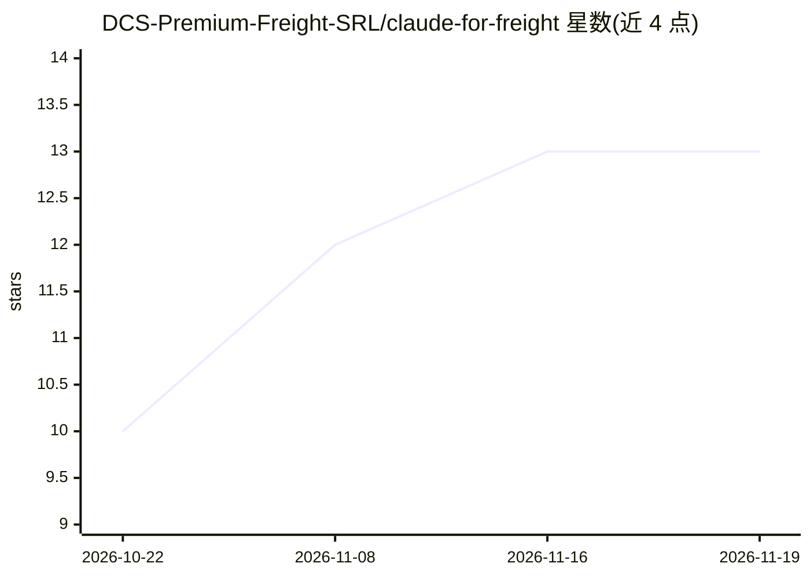

# DCS-Premium-Freight-SRL/claude-for-freight

⭐ 13 · Apache-2.0 · 推送 2026-05-14 · [GitHub](https://github.com/DCS-Premium-Freight-SRL/claude-for-freight) · 组织维护

**货运代理工作流的 Claude 插件套件：覆盖空海铁陆运输业务**

由罗马尼亚 DCS Premium Freight SRL 维护的货代业务插件集，基于 Anthropic 的三层架构：Markdown 技能形式的业务插件（RFQ 起草、货物计算、运输单证、海关清单、AOG 响应、包机定价等，仅 1 个达 v1.0，其余为 v0.x）、接入 TMS/e-AWB/汇率平台/海关系统的 MCP 连接器，以及基于权限矩阵（Authority Matrix）的托管 agent（夜间 RFQ 监控、AOG 应急响应等）。通过 cold-start interview 将公司业务规则写入 CLAUDE.md 供各技能读取。需 Claude Code 或 Claude Cowork 运行，输出仅为供人工复核的草稿。

## 筛选速览

| 维度 | 判定 | 备注 |
|---|---|---|
| AI 角色 | `ai-ecosystem` | LLM/agent 周边工具 |
| 许可风险 | `permissive` | Apache-2.0 |
| 部署形态 | `None` |  |
| 模型依赖 | locked-api |  |
| 硬件要求 | — | 无带数字的原话,不猜 |
| 安装摩擦 | `low` | 无编译、无系统依赖或容器化 |
| 成熟度 | — | 结构信号不足 |

## 能力要点

- 12 个货代业务插件：多式联运、清关、AOG、危险品、冷链等
- cold-start interview 生成 CLAUDE.md 业务档案供所有技能读取
- MCP 连接器接入 CargoWise、Riege Scope、e-AWB、海关系统等
- Authority Matrix 权限矩阵控制自动处理与预订阈值

## 适用场景

- 货代操作台起草 RFQ、计算货物与生成运输单证
- 夜间无人值守的 RFQ 监控与 AOG 事件响应
- 按公司业务规则定制 Claude 的货代工作流

## 场景标签

`工作流自动化` · 领域:效率与自动化

## 证据(README 行号)

> L3: A suite of plugins for freight forwarding workflows — air, sea, road, rail, and time-critical.
> L22: **MCP connectors.** Bring your operational reality into Claude — TMS (CargoWise, Riege Scope,
> L80: You need Claude Code or Claude Cowork. Then:

## 星数曲线

2026-10-22 10 → 2026-11-19 13（+3）

---
*卡片 v1 · prompt 1.4 · 生成 2026-11-18 · 置信度 high · 依据 README sha `a77690f3ad76` · [字段定义](../../DATASET.md)*
