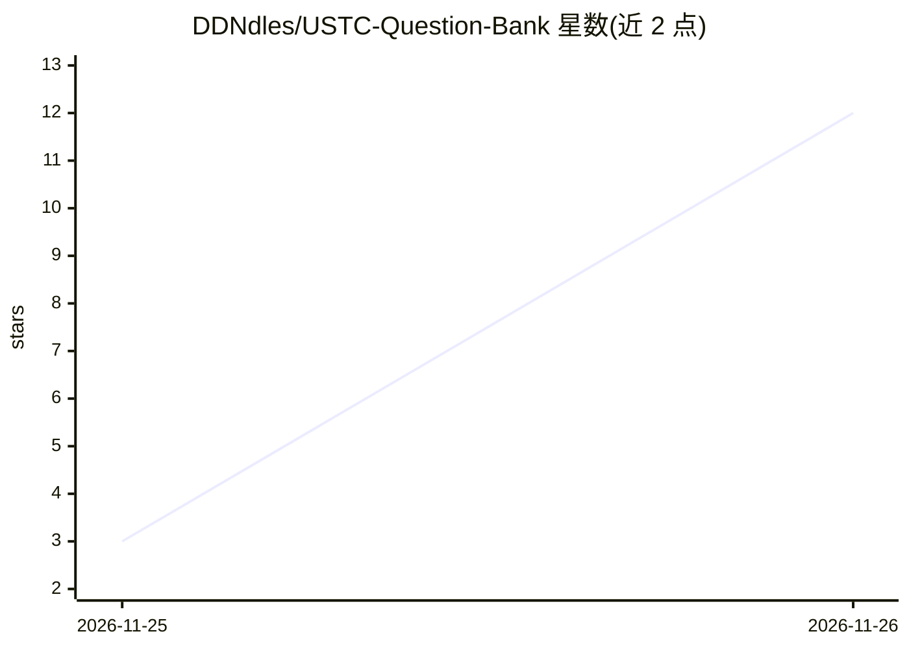

# DDNdles/USTC-Question-Bank

⭐ 12 · Python · MIT · 推送 2026-11-25 · [GitHub](https://github.com/DDNdles/USTC-Question-Bank) · 个人维护 · 中文 README

**面向 USTC 本科课程的结构化题库：题干、解析、知识点树与可信分级**

以 Markdown + LaTeX 存储题干、答案、分步解析、知识点树标签与可信分级的中国科学技术大学本科课程题库，共 16 门课程 7,627 题，纯文本 JSONL 入库并附 JSON Schema 与 manifest 索引。提供零第三方依赖的 Python 库（含按知识点、来源、难度查询与组卷采样）、SQLite FTS5 构建脚本与 TypeScript 类型定义，可直接驱动刷题网站、Anki 制卡、RAG 检索与评测基准。代码部分采用 MIT 许可，第三方真题与教材习题版权归原权利人。

## 筛选速览

| 维度 | 判定 | 备注 |
|---|---|---|
| AI 角色 | `ai-knowledge` | 知识聚合/清单类 |
| 许可风险 | `permissive` | MIT |
| 部署形态 | `library` | 以包/库形式分发 |
| 模型依赖 | — | README 未给出锁定关系 |
| 硬件要求 | — | 无带数字的原话,不猜 |
| 安装摩擦 | `low` | 无编译、无系统依赖或容器化 |
| 成熟度 | — | 结构信号不足 |

## 能力要点

- 16 门课程 7,627 题，100% 含答案与分步解析，按 official/community/ai 分级
- 纯文本 JSONL 存储并附 JSON Schema，预留带图题与选择题字段
- 零第三方依赖 Python 库，支持按知识点/来源/难度查询与随机组卷
- 提供 SQLite FTS5 构建脚本与 TypeScript 类型定义

## 适用场景

- 为刷题网站或 Anki 制卡工具提供结构化题目数据
- 把课程题目导入 RAG 流程做检索与问答
- 按知识点与难度抽取题目生成 LaTeX 试卷
- 构建课程复习与评测基准

## 场景标签

`模型评测` · 领域:评测与运维

## 证据(README 行号)

> L16: 面向中国科学技术大学（USTC）本科课程的**结构化、可编程题库底座**。每道题含 Markdown + LaTeX 题干、答案、分步解析、知识点树标签与可信分级，可直接驱动刷题网站、LaTeX 组卷、Anki 制卡、RAG 检索
> L110: - **Hugging Face / RAG**：`load_dataset("json", data_files="courses/MATH1006/questions.jsonl")`

## 星数曲线

2026-11-25 3 → 2026-11-26 12（+9）

---
*卡片 v1 · prompt 1.4 · 生成 2026-11-24 · 置信度 high · 依据 README sha `048d7659fd04` · [字段定义](../../DATASET.md)*
