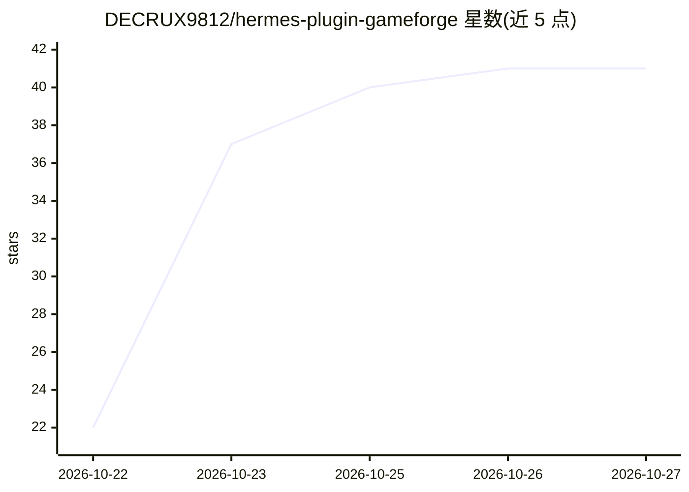

# DECRUX9812/hermes-plugin-gameforge

⭐ 41 · Python · MIT · 推送 2026-10-26 · [GitHub](https://github.com/DECRUX9812/hermes-plugin-gameforge) · 个人维护

**Hermes Agent 的游戏开发插件：生成素材、构建与自动化试玩**

面向 Hermes Agent 的标准 plugin.yaml 插件，为 agent 提供 10 个游戏开发工具：程序化生成音效、循环音乐、NPC 语音、像素精灵图、瓦片集与低多边形 3D 模型，支持 web/Godot/Unity 构建、Blender/Unreal 管线，并含一个在无头 Chrome 或 Godot 中实际试玩构建、产出 HTML 报告与 SOLID/BROKEN 判定的 playtester，及一键导出到 web/手机/itch.io。默认全部离线运行（纯 Python + Pillow），fal.ai、Meshy、ElevenLabs、Edge TTS 为可选升级。

## 筛选速览

| 维度 | 判定 | 备注 |
|---|---|---|
| AI 角色 | `ai-ecosystem` | LLM/agent 周边工具 |
| 许可风险 | `permissive` | MIT |
| 部署形态 | `None` |  |
| 模型依赖 | — | README 未给出锁定关系 |
| 硬件要求 | — | 无带数字的原话,不猜 |
| 安装摩擦 | `medium` | 含编译或系统依赖之一 |
| 成熟度 | — | 结构信号不足 |

## 能力要点

- 10 个工具覆盖音效/音乐/语音/精灵/瓦片/3D/引擎/试玩/导出
- playtester 用无头 Chrome（explorer/monkey/vision-LLM agent）或 40 倍速 Godot 机器人实际游玩并出报告
- 默认完全离线运行，AI 提供商为可选升级
- 资产台账记录生成配方与许可，程序化输出为 CC0

## 适用场景

- 通过 AI agent 一句话生成可玩的游戏原型并自动试玩
- 为 Godot/Unity/web 项目批量生成美术与音频资产
- 自动试玩游戏构建并产出崩溃、卡点与 FPS 诊断报告

## 场景标签

`图像生成` `语音合成` `浏览器自动化` · 领域:效率与自动化

## 证据(README 行号)

> L3: **The game-development plugin for Hermes Agent.**
> L11: Nothing touches Hermes core: it is a standard `plugin.yaml` + `register(ctx)` plugin.

## 星数曲线

2026-10-22 22 → 2026-10-27 41（+19）

---
*卡片 v1 · prompt 1.4 · 生成 2026-10-25 · 置信度 mid · 依据 README sha `3b9cfd8b8e8e` · [字段定义](../../DATASET.md)*
