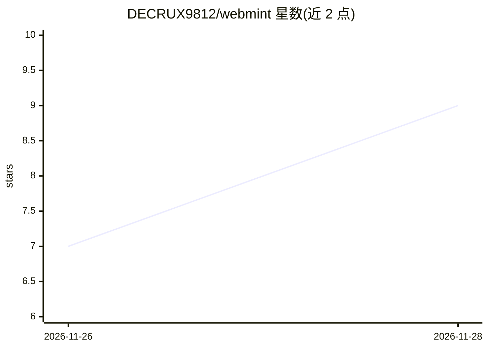

# DECRUX9812/webmint

⭐ 9 · Python · MIT · 推送 2026-10-29 · [GitHub](https://github.com/DECRUX9812/webmint) · 个人维护

**给 Hermes Agent 用户把网站固化成可复用工具的插件**

Hermes Agent 插件：用宿主 agent 已接入的模型对目标网页做一次捕捉与学习，生成声明式 JSON 规格，经两次运行校验（两次结果一致且字段非空率达标）后存为工具，此后执行不再调用模型。产物为用户自有的 tool.json，可手改与提交版本库。默认以全新无 Cookie 浏览器捕捉，不回放登录凭据，仅访问公开 http(s) URL。限制包括部分站点被反爬拦截、选择器会随页面改版失效、弱模型生成的规格质量更差。

## 筛选速览

| 维度 | 判定 | 备注 |
|---|---|---|
| AI 角色 | `ai-ecosystem` | LLM/agent 周边工具 |
| 许可风险 | `permissive` | MIT |
| 部署形态 | `None` |  |
| 模型依赖 | — | README 未给出锁定关系 |
| 硬件要求 | — | 无带数字的原话,不猜 |
| 安装摩擦 | `low` | 无编译、无系统依赖或容器化 |
| 成熟度 | — | 结构信号不足 |

## 能力要点

- 捕捉一次生成声明式规格，执行时无模型参与（平均约 3.5 秒/次）
- 规格需两次运行结果一致且字段非空才被保存，否则拒绝并修复
- 模型无关：调用宿主的 ctx.llm，不硬编码任何供应商
- 产物 tool.json 可读、可手改、可版本管理

## 适用场景

- 让 agent 从固定网站稳定提取结构化数据而无需每次重新浏览
- 为常用网站构建可提交版本库的抓取工具
- 在 agent 流程中替代逐次开浏览器读屏的低效路径

## 场景标签

`浏览器自动化` `网页抓取` · 领域:效率与自动化

## 证据(README 行号)

> L10: hermes plugins install DECRUX9812/webmint
> L33: |**Model-agnostic**|The mint calls the host's own `ctx.llm`. Whatever provider/model your agent is on does the work
> L44: |`webmint_run`|Execute a minted spec with new inputs (no model)|

## 星数曲线

2026-11-26 7 → 2026-11-28 9（+2）

---
*卡片 v1 · prompt 1.4 · 生成 2026-11-26 · 置信度 high · 依据 README sha `787dc7a974d0` · [字段定义](../../DATASET.md)*
